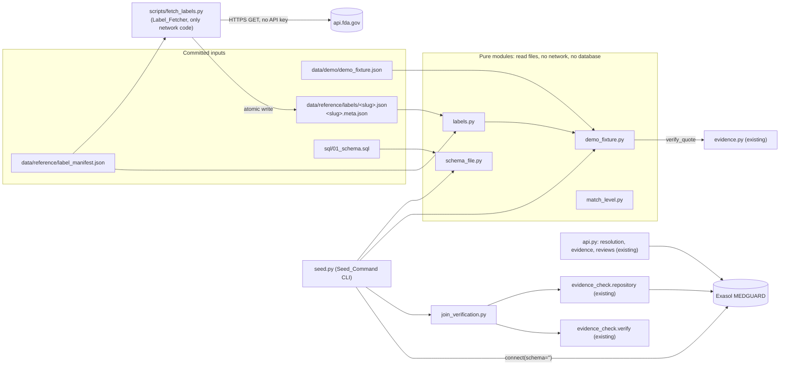
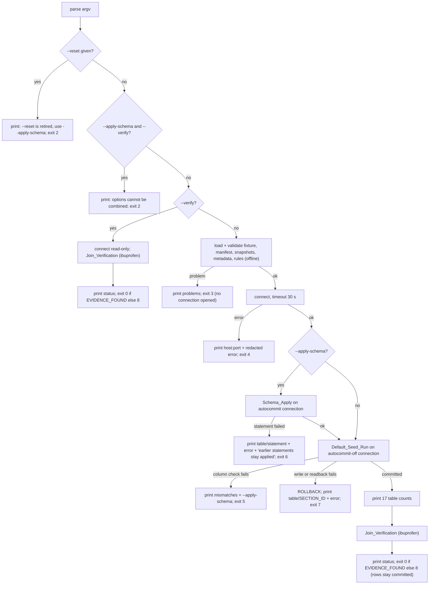

# Design Document: demo-data-foundation

## Overview

This feature builds the MedGuard data layer that the existing listener, resolution, evidence-check,
review and synthesis code already expects. It delivers:

- the 17-table canonical schema (`sql/01_schema.sql` plus five small adjustments) and an explicit,
  destructive `--apply-schema` mode that drops the six legacy tables;
- one deterministic synthetic patient, her medications, pill appearances, nine dated labs and the
  10-utterance Demo_Script, all from one committed fixture file;
- committed openFDA label snapshots, fetched once by a separate network script and imported with
  provenance and a SHA-256 per section;
- drug, class, synonym and three curated risk rules whose quotes are checked in code against the stored
  section text;
- a post-seed check and a read-only `--verify` mode that call the existing evidence join and verifier and
  report one Join_Status.

The design adds no new evidence query and no second quote verifier. `verify_quote` in
`src/hackathon26/evidence.py` is the Quote_Verifier. `EVIDENCE_JOIN_QUERY`, `EvidenceRepository.fetch` and
`verify_rows` in `src/hackathon26/evidence_check/` are the Evidence_Join_Query and Join_Verification core.
This spec adds only a small adapter that turns their results and exceptions into the six Join_Status values.

Everything stays a local CLI. No AWS service is needed (see "AWS integration notes").

### Research findings that shape the design

| Finding                                                                                                                                                                                                                                                                                                                                                                                                                                           | How it was checked                                          | Design consequence                                                                                                                                                                                                                                                                                                                      |
| ------------------------------------------------------------------------------------------------------------------------------------------------------------------------------------------------------------------------------------------------------------------------------------------------------------------------------------------------------------------------------------------------------------------------------------------------- | ----------------------------------------------------------- | --------------------------------------------------------------------------------------------------------------------------------------------------------------------------------------------------------------------------------------------------------------------------------------------------------------------------------------- |
| The openFDA query `search=set_id:"01da05d8-e72e-4208-bf92-a5cd929f15ab"` returns HTTP 200 with `meta.results.total` 1 (71 KB body). The label has `effective_time` 20220701, version 6, and four imported fields with one element each: `boxed_warning`, `contraindications`, `warnings_and_cautions` (10,223 characters), `drug_interactions` (3,771 characters). It has no `warnings` field. `openfda.manufacturer_name` is "Proficient Rx LP". | Read-only request during design, 13 Nov 2026                | The fetcher URL form works. Both Evidence_Quotes in Requirement 10 are exact substrings of element 0 of `drug_interactions` and of `warnings_and_cautions` (checked with Python `in`).                                                                                                                                                  |
| openFDA allows 240 requests per minute and 1,000 per day per IP without an API key ([openFDA authentication](https://open.fda.gov/apis/authentication/)). The requirements author still saw one HTTP 429.                                                                                                                                                                                                                                         | Docs plus the requirements' fetch log                       | Four to six requests, at least 1 s apart, with a 5 s back-off on 429, stay far below the limit.                                                                                                                                                                                                                                         |
| Exasol DDL is transactional: the docs show a `CREATE TABLE` undone by `ROLLBACK` ([Exasol transaction management](https://docs.exasol.com/db/latest/database_concepts/transaction_management.htm)).                                                                                                                                                                                                                                               | Docs                                                        | DDL does not commit on its own in Exasol. Schema_Apply therefore runs on a connection with **autocommit on**, so each statement commits when it succeeds. This is the behaviour Requirement 2.8 describes ("statements executed before the failure stay applied"). The Default_Seed_Run uses a separate connection with autocommit off. |
| Exasol evaluates an empty string as NULL ([Exasol data type details](https://docs.exasol.com/db/7.1/sql_references/data_types/datatypedetails.htm)).                                                                                                                                                                                                                                                                                              | Docs                                                        | The fixture loader rejects empty strings (use JSON `null`). The importer never writes empty SECTION_TEXT (Requirement 8.8 skips it). The storage round trip in Requirement 8.10 would catch any other conversion.                                                                                                                       |
| Target_Database is Exasol **2026.1.0**. Session `NLS_DATE_FORMAT` is `YYYY-MM-DD`, `NLS_TIMESTAMP_FORMAT` is `YYYY-MM-DD HH24:MI:SS.FF6`, `NLS_NUMERIC_CHARACTERS` is `.,`. `SYS.EXA_ALL_COLUMNS.COLUMN_TYPE` reports types such as `DECIMAL(10,0)`, `VARCHAR(100) UTF8` and `TIMESTAMP(3)`. MEDGUARD holds exactly the six legacy tables (AUDIT_LOG 0, DISPENSING 1043, DRUG_PRODUCT 63, PATIENT 24, PRESCRIPTION 149, REVIEW_QUEUE 0 rows).     | Read-only queries through `connect(schema="")`, 13 Nov 2026 | Base type = text before the first `(` or space. The seed sends DATE and TIMESTAMP values as strings in exactly those NLS formats and checks the formats before writing.                                                                                                                                                                 |
| pyexasol 4.0.0 `ext.insert_multi` runs a prepared `INSERT` and encodes rows with the stdlib `json` module, which cannot encode `Decimal`, `date` or `datetime`. `connect()` accepts a `connection_timeout` option (default 10 s). Identifier conversion `{x!i}` validates and formats a name or a `(schema, table)` tuple.                                                                                                                        | Installed source in `.venv`                                 | Rows are built with Python types, then converted to JSON-safe wire values just before `insert_multi`. Identifiers use `{t!i}` with names from constants only. The seed calls `connect(..., connection_timeout=30)` for Requirement 3.11.                                                                                                |
| `db.connect()` runs `OPEN SCHEMA <EXASOL_SCHEMA>` when that setting is non-empty, and `.env` sets it. `connect(schema="")` skips that step.                                                                                                                                                                                                                                                                                                       | `src/hackathon26/db.py`                                     | The seed always calls `connect(schema="", ...)` and qualifies every name with `MEDGUARD.`. This works before MEDGUARD exists and whatever `EXASOL_SCHEMA` says (Requirement 16.3).                                                                                                                                                      |

## Architecture



### Command modes



All offline validation runs before any connection. A broken snapshot or fixture therefore never leaves
the schema emptied by a half-finished `--apply-schema`.

### Module layout

| Path                                   | Kind              | Responsibility                                                                                                         |
| -------------------------------------- | ----------------- | ---------------------------------------------------------------------------------------------------------------------- |
| `src/hackathon26/match_level.py`       | new, pure         | The five Match_Level codes, ranks and labels (Requirement 1.9, 1.10).                                                  |
| `src/hackathon26/schema_file.py`       | new, pure         | Split the Schema_File into statements, parse table and column definitions, classify live tables, compare live columns. |
| `src/hackathon26/labels.py`            | new, pure         | Label_Manifest, Snapshot_Metadata, snapshot validation, Label_Importer. Shared by the fetcher and the seed.            |
| `src/hackathon26/demo_fixture.py`      | new, pure         | Load and validate the Demo_Fixture, enumerate Curated_Text, `build_rows`.                                              |
| `src/hackathon26/join_verification.py` | new, pure adapter | Map existing evidence results and exceptions to the six Join_Status values; format the report.                         |
| `src/hackathon26/seed.py`              | rewritten         | Seed_Command CLI: Schema_Apply, Default_Seed_Run, Verify_Mode. The only module that writes to Exasol.                  |
| `scripts/fetch_labels.py`              | new               | Label_Fetcher: stdlib `urllib`, the only code that contacts openFDA.                                                   |
| `data/demo/demo_fixture.json`          | new               | The Demo_Fixture.                                                                                                      |
| `data/reference/label_manifest.json`   | new               | The Label_Manifest.                                                                                                    |
| `data/reference/labels/`               | new               | Label_Snapshots and Snapshot_Metadata, committed.                                                                      |
| `sql/01_schema.sql`                    | edited            | Five adjustments listed in Data Models.                                                                                |
| `pyproject.toml`                       | edited            | Add `hypothesis` to the `dev` group.                                                                                   |

### Design decisions

1. **Demo_Fixture is a JSON file, not a Python constant module.** Requirements 3.4, 3.5 and 17.4 speak of
   byte-identical fixture files that the tests read directly, which a data file makes literal. JSON paths
   such as `utterances[3].text` give Requirement 14.1 its "field that holds the value". The UI spec can
   replay the same script from the same file. The cost is no comments and string-encoded dates and
   decimals, which `demo_fixture.py` parses strictly with pydantic (already used across `src/hackathon26`).
   Decimal values are JSON strings (`"0.97"`) so no float rounding is possible.
2. **One validator, used by both the seed and the tests.** `fixture_problems()` checks every fixture
   invariant from Requirements 4, 5, 6, 9 and 10. The seed refuses to connect if it returns anything. The
   unit tests assert it returns nothing for the committed fixture and the right problem for mutated
   fixtures. The trust-word and banned-phrase checks stay in the tests, because Requirement 14.4 says the
   Banned_Phrase_List is committed with the tests.
3. **Validate offline, then connect.** See the flowchart above.
4. **Schema_Apply uses autocommit; the seed uses one transaction.** Explained in the research table.
5. **Column lists come from the Schema_File.** `build_rows` emits dicts keyed by column name. The writer
   orders values by the column order that `schema_file.py` parses from `sql/01_schema.sql` and passes that
   list as `columns=` to `insert_multi`. A unit test asserts each built row has exactly the Schema_File
   columns, so the fixture and the DDL cannot drift apart.
6. **Positional SECTION_IDs.** The formula is `SECTION_ID = 1000 × m + 100 × f + e`, where m is the
   1-based manifest position, f the 1-based field position in Glossary order and e the element index.
   IDs grow in the order Requirement 8.3 demands. A refreshed snapshot of one drug cannot renumber another
   drug's sections. The rules name their evidence as
   (drug, field, element), and `build_rows` computes the ID.
7. **Optional_Drugs are left out of the manifest for tonight.** If spironolactone were seeded, a
   spironolactone candidate check would return NO_DOCUMENTED_INTERACTION_FOUND, because no rule requires
   'potassium-sparing diuretic', even though the ramipril label names potassium-sparing diuretics. Left
   out, the same check returns UNKNOWN_CANDIDATE, which is the honest answer. The fixture still records
   their IDs, RxCUIs and classes, so a later rule can add them with one manifest line each.
8. **The seed never imports network clients.** `seed.py`, `labels.py`, `demo_fixture.py`,
   `schema_file.py` and `join_verification.py` import no `urllib.request`, `http.client`, `socket`,
   `boto3`, `requests` or `hackathon26.bedrock`. `labels.py` may import `urllib.parse`, which only formats
   strings. A unit test scans their imports (Requirement 3.10).

## Components and Interfaces

Signatures are indicative; implementation tasks may refine names but not behaviour.

### `match_level.py`

```python
class MatchLevel(StrEnum):
    NAME_MATCH = "NAME_MATCH"; COLOUR_SHAPE_MATCH = "COLOUR_SHAPE_MATCH"; COLOUR_MATCH = "COLOUR_MATCH"
    CLASS_INFERRED = "CLASS_INFERRED"; UNRESOLVED = "UNRESOLVED"

class UnknownMatchLevel(ValueError): ...          # message contains repr(value)

def rank(code: str) -> int        # 1 (NAME_MATCH) .. 5 (UNRESOLVED)
def label(code: str) -> str       # "name match", "colour + shape match", "colour match", "class inferred", "unresolved"
```

Lookup is exact membership in a dict keyed by the five strings. No strip, no case folding, so
`" NAME_MATCH"` and `"name_match"` raise `UnknownMatchLevel`.

### `schema_file.py`

```python
def split_statements(sql: str) -> list[str]
def parse_tables(sql: str) -> dict[str, list[ColumnDef]]   # table -> columns in file order
def classify_live_tables(live: dict[str, set[str]], canonical: set[str]) -> TableInventory
def compare_columns(expected: dict[str, list[ColumnDef]], live: dict[str, dict[str, str]]) -> list[ColumnMismatch]

@dataclass(frozen=True)
class ColumnDef: name: str; type_text: str; base_type: str; not_null: bool; default: str | None; in_primary_key: bool
```

- `split_statements` deletes every `--` comment up to the end of its line, splits on `;`, strips each
  piece and drops empty pieces. This handles the semicolon inside the FINDING comment ("DRUG_LABEL_SECTION;
  the loader verifies this"). A unit test asserts the Schema_File contains no `'` outside comments, so no
  string literal can hide a `--` or `;`.
- `parse_tables` reads each `CREATE OR REPLACE TABLE <name> (` block. Each line inside is either a column
  (`NAME TYPE [DEFAULT x] [NOT NULL]`) or a `PRIMARY KEY (...)` clause. `base_type` is the type name before
  `(`, so `CHAR(64)` gives `CHAR`.
- Live base type is `COLUMN_TYPE` up to the first `(` or space (`VARCHAR(100) UTF8` gives `VARCHAR`,
  `TIMESTAMP(3)` gives `TIMESTAMP`).
- `classify_live_tables` marks each live MEDGUARD table as one of:
  - `LEGACY_DROP`: DRUG_PRODUCT, PRESCRIPTION, DISPENSING or REVIEW_QUEUE; PATIENT with a `LANGUAGE`
    column; AUDIT_LOG with `EVENT_ID`, `ACTOR` and `EVENT_ACTION` columns.
  - `CANONICAL_REPLACE`: any other table with a canonical name.
  - `UNMANAGED`: anything else, left untouched (Requirement 2.6).

### `labels.py`

```python
IMPORTED_FIELDS = ("boxed_warning", "contraindications", "warnings", "warnings_and_cautions", "drug_interactions")
DEMO_DRUGS = ("ramipril", "metoprolol succinate", "furosemide", "ibuprofen")
OPTIONAL_DRUGS = ("spironolactone", "potassium chloride")
SET_ID_RE = r"\A[0-9a-f]{8}-[0-9a-f]{4}-[0-9a-f]{4}-[0-9a-f]{4}-[0-9a-f]{12}\Z"

@dataclass(frozen=True) class ManifestEntry: generic_name: str; set_id: str; position: int   # 1-based
@dataclass(frozen=True) class SnapshotMetadata: request_url: str; fetched_at: datetime; sha256: str
@dataclass(frozen=True) class LoadedLabel: entry: ManifestEntry; label: dict; metadata: SnapshotMetadata
@dataclass(frozen=True) class SectionRow: section_id: int; generic_name: str; section_type: str; element: int;
                                          text: str; content_sha256: str
class LabelError(Exception): drug: str; check: str          # str() names both

def slug(generic_name: str) -> str                           # "metoprolol succinate" -> "metoprolol-succinate"
def load_manifest(path: Path) -> list[ManifestEntry]         # Requirement 7.1, 7.13, 9.11
def request_url(set_id: str) -> str
def write_metadata(path: Path, meta: SnapshotMetadata) -> None
def read_metadata(path: Path) -> SnapshotMetadata
def check_response(entry: ManifestEntry, body: bytes) -> dict   # fetch-time checks, Requirement 7.5
def load_label(entry: ManifestEntry, label_dir: Path) -> LoadedLabel   # seed-time checks, Requirement 8.2, 8.7
def import_sections(loaded: LoadedLabel) -> tuple[list[SectionRow], list[str]]   # rows, notices
def content_hash(text: str) -> str                           # sha256(text.encode("utf-8")).hexdigest()
```

- `request_url(set_id)` returns
  `https://api.fda.gov/drug/label.json?search=set_id%3A%22<set_id>%22`, built with
  `urllib.parse.urlencode({"search": f'set_id:"{set_id}"'})`. It is a pure string function; `labels.py`
  imports only `urllib.parse`, which opens no connection.
- `content_hash` is byte-for-byte what `evidence_check/verify.py` computes
  (`sha256(section_text.encode()).hexdigest()`; `str.encode()` defaults to UTF-8). A text that cannot be
  encoded as UTF-8 (a lone surrogate from a `\ud800` JSON escape) raises `LabelError` naming the drug and
  field, because Exasol could not store it either.
- `write_metadata` writes the three keys `request_url`, `fetched_at` and `sha256` as JSON with
  `indent=2`, `sort_keys=True`, `ensure_ascii=False` and a trailing newline, with `fetched_at` formatted
  as `YYYY-MM-DDTHH:MM:SSZ`. `read_metadata` accepts only that form, a non-empty URL and a 64-character
  lowercase hex SHA-256, and returns a UTC-aware datetime.
- `load_label` checks, in order, and raises `LabelError(drug, check)` at the first failure: snapshot file
  present, metadata file present, SHA-256 of snapshot bytes equals metadata `sha256`, JSON parses,
  `results` has exactly one element, `set_id` present, `set_id` equals the pinned set id, `effective_time`
  is 8 digits and a real calendar date (`datetime.strptime(v, "%Y%m%d")`). For a missing or mismatched
  file, the message includes `uv run python scripts/fetch_labels.py`.
- `import_sections` walks `IMPORTED_FIELDS` in order. Absent fields are skipped. For each list element
  at index `e`, a string of length ≥ 1 becomes one `SectionRow` with
  `section_id = 1000 * position + 100 * (field_index + 1) + e`. An empty string adds the notice
  "`<drug>`: empty `<field>` element skipped" (Requirement 8.8). An element index of 100 or more raises
  `LabelError`. Zero rows add the notice "no label sections were imported for `<drug>`" (Requirement 8.13).
  Text is stored exactly as JSON-decoded.

### `scripts/fetch_labels.py` (Label_Fetcher)

```python
def fetch_all(entries, label_dir, *, transport=urllib_transport, clock=time.monotonic,
              sleep=time.sleep, now=utc_now, out=sys.stdout) -> int    # exit status
def main(argv=None) -> int
```

- Inserts `<repo>/src` on `sys.path` (same pattern as `scripts/preflight.py`) and imports only
  `hackathon26.labels`. It never imports `hackathon26.db`, so it cannot open a database connection
  (Requirement 7.11).
- `load_manifest` runs first. Any manifest fault prints the entry and exits 2 before any request
  (Requirement 7.13).
- One GET per entry, in manifest order, to `request_url(set_id)`, with no API key and a
  `User-Agent: medguard-hackathon-label-fetcher` header. Before each attempt it sleeps until at least
  1.0 s has passed since the previous attempt started (Requirement 7.7).
- HTTP 429: sleep at least 5 s (and the 1 s spacing still applies), then repeat. At most 3 repeats
  (Requirement 7.8).
- Timeouts: socket timeout 30 s, plus a read loop that aborts once 30 s have passed since the request
  started (Requirement 7.9 "runs longer than 30 seconds").
- On success (`check_response` passes) it writes `<slug>.json.tmp` and `<slug>.meta.json.tmp` in
  `data/reference/labels/`, then `os.replace`s both. On any failure it writes nothing for that entry,
  records the reason and continues. It prints the generic name and SHA-256 of each saved snapshot
  (Requirement 7.6).
- Exit status: 0 when every entry saved (Requirement 7.14), 1 when any entry failed (list printed),
  2 for a manifest fault.
- `transport`, `clock`, `sleep` and `now` are injectable so tests run with a fake server and fake time.

### `demo_fixture.py`

```python
class DemoFixture(BaseModel): ...      # strict, extra="forbid", frozen; structure in Data Models

@dataclass(frozen=True) class Problem: field: str; requirement: str; message: str

def load_fixture(path: Path) -> DemoFixture                       # raises FixtureError with JSON path
def fixture_problems(fx: DemoFixture, labels: list[LoadedLabel], manifest: list[ManifestEntry]) -> list[Problem]
def curated_text(fx: DemoFixture) -> Iterator[tuple[str, str, bool]]   # (json_path, value, is_utterance)
def build_rows(fx: DemoFixture, labels: list[LoadedLabel], manifest: list[ManifestEntry],
               columns: dict[str, list[str]]) -> SeedRows
SeedRows = dict[str, list[dict[str, Value]]]                      # table -> rows; Value = int|str|bool|Decimal|date|datetime|None
def evidence_sections(labels, manifest) -> dict[tuple[str, str, int], SectionRow]   # (drug, field, element) -> row
```

`fixture_problems` reports, each with its JSON path:

| Check                                                                                                                                                                                                                                                                                                           | Requirement        |
| --------------------------------------------------------------------------------------------------------------------------------------------------------------------------------------------------------------------------------------------------------------------------------------------------------------- | ------------------ |
| Every medication and appearance names a drug that will have a DRUG row in this run                                                                                                                                                                                                                              | 4.10               |
| Exactly two current medications are white (ramipril, furosemide), one yellow; ramipril and furosemide share SCHEDULE_TEXT; their SHAPE values differ and are non-null                                                                                                                                           | 4.6, 4.7           |
| Each appearance belongs to a current medication; one appearance per current medication; IMPRINT null; SRC_NAME contains "synthetic" (case-insensitive)                                                                                                                                                          | 4.5, 4.8           |
| Every MANUFACTURER differs, case-insensitively, from every `openfda.manufacturer_name` in the loaded snapshots                                                                                                                                                                                                  | 4.9                |
| Lab completeness, REF_LOW < REF_HIGH, date window, distinct dates, trend direction, first flag FALSE and last flag TRUE                                                                                                                                                                                         | 5.4, 5.5, 5.6, 5.8 |
| Speakers alternate DOCTOR/PATIENT from SEQ 1; SEQ is 1..10; required phrases at the required SEQs; "ibuprofen" only in SEQ 8; no other drug name; OFFSET_MS 0, steps ≥ 2000, ≤ 90000; text 1–4000 characters with a non-space; no digit and no "mg", "milligram(s)", "once a day", "twice a day", "times a day" | 6.2–6.11           |
| Each required class equals a seeded CLASS_NAME exactly; each is grounded in the quote (class name or synonym, case-insensitive) or owned by the evidence section's drug                                                                                                                                         | 9.8, 9.9, 9.12     |
| Each rule's evidence (drug, field, element) exists and `verify_quote(quote, section.text)` is true                                                                                                                                                                                                              | 10.6, 11.7         |
| Every non-optional fixture drug is in the manifest and every manifest drug is in the fixture                                                                                                                                                                                                                    | 9.1, 9.11          |
| Every string value fits its Schema_File VARCHAR/CHAR length (for SECTION_TEXT: 2,000,000)                                                                                                                                                                                                                       | 8.11               |

`build_rows` is a pure function of its inputs. It reads no clock, environment or random source.

### `join_verification.py`

```python
JoinStatus = Literal["EVIDENCE_FOUND", "NO_DOCUMENTED_INTERACTION_FOUND", "EVIDENCE_UNVERIFIED",
                     "UNKNOWN_PATIENT", "UNKNOWN_CANDIDATE", "QUERY_FAILED"]

@dataclass(frozen=True)
class JoinVerification: status: JoinStatus; detail: str; result: EvidenceResult | None

def verify_join(patient_id: int, as_of: date, *, candidate_drug_id: int | None = None,
                candidate_class_name: str | None = None, source: EvidenceSource,
                redact: Callable[[str], str] = str) -> JoinVerification
def format_report(v: JoinVerification) -> str
```

| Step                                                                                                                                | Outcome                                                                                                                                              |
| ----------------------------------------------------------------------------------------------------------------------------------- | ---------------------------------------------------------------------------------------------------------------------------------------------------- |
| `EvidenceRequest(as_of, candidate_drug_id, candidate_class_name)` raises pydantic `ValidationError` (both, neither, or blank class) | `UNKNOWN_CANDIDATE`, detail names both parameters; no query sent (Requirement 12.13)                                                                 |
| `source.fetch` raises `UnknownPatient`                                                                                              | `UNKNOWN_PATIENT` (Requirement 13.6). The repository checks the patient before the join.                                                             |
| `source.fetch` raises `UnknownCandidate`                                                                                            | `UNKNOWN_CANDIDATE` naming the candidate (Requirements 12.14, 13.14)                                                                                 |
| `source.fetch` raises `EvidenceStoreUnavailable`                                                                                    | `QUERY_FAILED`; detail is the redacted text of `error.__cause__` (the database error), or the exception text if there is no cause (Requirement 13.7) |
| otherwise `verify_rows(patient_id, request, rows)`                                                                                  | its `status` (EVIDENCE_FOUND, EVIDENCE_UNVERIFIED or NO_DOCUMENTED_INTERACTION_FOUND), `message`, findings and failures                              |

`format_report` prints the status, then the message. For EVIDENCE_FOUND it prints, per finding: RULE_NAME,
ANALYTE and DIRECTION, the quote, SECTION_ID, LABEL_SET_ID, LABEL_EFFECTIVE_AT, supplying medications,
each lab as value, unit, date and "outside reference range: yes/no", and the limitations. For
EVIDENCE_UNVERIFIED it prints each failure line. For NO_DOCUMENTED_INTERACTION_FOUND the message is
`verify_rows`' fixed text "no documented interaction found". `verify_join` returns one status and never
exits (Requirement 13.12).

The seed builds its `EvidenceSource` as `EvidenceRepository(lambda: connect(schema="", connection_timeout=30))`.

### `seed.py` (Seed_Command)

```text
uv run python src/hackathon26/seed.py                 # Default_Seed_Run, then Join_Verification
uv run python src/hackathon26/seed.py --apply-schema  # Schema_Apply, then Default_Seed_Run, then Join_Verification
uv run python src/hackathon26/seed.py --verify        # Verify_Mode: Join_Verification only, writes nothing
uv run python scripts/fetch_labels.py                 # Label_Fetcher, the only command that contacts openFDA
```

```python
def main(argv: list[str] | None = None, *, connect_factory=connect, out=sys.stdout, err=sys.stderr) -> int
```

When run as a script, `seed.py` puts `<repo>/src` on `sys.path` before importing `hackathon26.*`
(running `python src/hackathon26/seed.py` otherwise puts only `src/hackathon26` there). The module
docstring gives the four command lines above and states that Schema_Apply drops the Legacy_Tables and
recreates every Canonical_Table empty, App_Written_Tables included; that Verify_Mode writes no rows; that
only the Label_Fetcher contacts openFDA; and that `--reset` is retired (Requirement 15.5). `--reset` stays
a hidden argparse flag whose only effect is the retirement message and exit 2 (Requirement 15.4).

**Schema_Apply** (connection: `connect_factory(schema="", autocommit=True, connection_timeout=30)`):

1. Print host and port (from `db.settings()`, never the password), the database version from
   `EXA_METADATA` and the schema name MEDGUARD (Requirement 2.2).
2. Read `SYS.EXA_ALL_TABLES` and `SYS.EXA_ALL_COLUMNS` for MEDGUARD. Run `classify_live_tables`. Print
   each table's name, `SELECT COUNT(*) FROM {t!i}` and its mark: "to be dropped", "to be replaced empty"
   or "unmanaged, left unchanged" (Requirements 2.3, 2.6).
3. For each `LEGACY_DROP` table: `DROP TABLE IF EXISTS {t!i}` with `t = ("MEDGUARD", name)`.
4. Execute every `split_statements(Schema_File)` statement in order. The first two are
   `CREATE SCHEMA IF NOT EXISTS MEDGUARD` and `OPEN SCHEMA MEDGUARD` (a unit test pins this), so the
   unqualified `CREATE OR REPLACE TABLE` statements land in MEDGUARD.
5. On a failure in step 3 or 4: print the target table (regex on `TABLE|SCHEMA <name>`) or the statement
   text, the database error, and "Statements executed before this failure stay applied. Fix the cause and
   re-run --apply-schema."; exit 6. A re-run is safe because every statement is idempotent
   (`IF EXISTS`, `IF NOT EXISTS`, `CREATE OR REPLACE`) (Requirement 2.9).
6. Post-check: `compare_columns` with base types, no table named DRUG_PRODUCT, PRESCRIPTION, DISPENSING
   or REVIEW_QUEUE, and zero rows in each App_Written_Table (Requirement 2.5). Failure exits 6.
7. Continue with the Default_Seed_Run in the same invocation (Requirement 2.7).

**Default_Seed_Run** (connection: `connect_factory(schema="", autocommit=False, connection_timeout=30)`):

1. Column check: `SYS.EXA_SCHEMAS` has MEDGUARD, and for each of the 17 tables the set of
   `SYS.EXA_ALL_COLUMNS` names equals the Schema_File set. On a mismatch print each table with its
   missing and unexpected columns and "run with --apply-schema"; write nothing; exit 5 (Requirements 3.1,
   3.2).
2. Format check: `SELECT PARAMETER_NAME, SESSION_VALUE FROM EXA_PARAMETERS` must give
   `NLS_DATE_FORMAT = YYYY-MM-DD`, `NLS_TIMESTAMP_FORMAT = YYYY-MM-DD HH24:MI:SS.FF6` and
   `NLS_NUMERIC_CHARACTERS = .,`. Otherwise write nothing and exit 7. The seed does not use
   `ALTER SESSION`, because Requirement 15.3 forbids ALTER outside Schema_Apply.
3. For each Seed_Owned_Table in this fixed order: DRUG, DRUG_CLASS, CLASS_SYNONYM, DRUG_LABEL_SECTION,
   DRUG_APPEARANCE, PATIENT, PATIENT_MEDICATION, LAB_RESULT, RISK_LAB_RULE, RISK_RULE_CLASS, CONSULTATION,
   UTTERANCE: `DELETE FROM {t!i}`, then `conn.ext.insert_multi(("MEDGUARD", name), wire_rows, columns=cols)`.
   There are no foreign keys, so the order only has to be fixed, not dependency-sorted.
4. Storage round trip: in the same transaction, read SECTION_ID, SECTION_TEXT and CONTENT_SHA256 from
   `MEDGUARD.DRUG_LABEL_SECTION` ordered by SECTION_ID. Every written ID must come back with identical
   text, and `content_hash(text)` must equal the stored hash (Requirement 8.10).
5. `COMMIT`. Any exception in steps 3–5, or a round-trip mismatch, triggers `ROLLBACK`, prints the table
   (or SECTION_ID, drug and SECTION_TYPE) and the redacted error, and exits 7 (Requirements 3.7, 8.12).
6. Print `SELECT COUNT(*)` for all 17 Canonical_Tables (Requirement 3.8).
7. Run `verify_join(1, date(2026, 11, 13), candidate_drug_id=104, ...)`, print `format_report`, and exit 0
   on EVIDENCE_FOUND or 8 otherwise, without rolling back (Requirements 13.8, 13.9, 13.11).

**Verify_Mode**: loads only the Demo_Fixture (for the patient id, `as_of` and ibuprofen's DRUG_ID; a
load error exits 3), then runs step 7 on an autocommit connection that executes only `SELECT`s
(Requirement 13.10).

**Credential hygiene**: every printed exception text passes through `redact()`, which replaces the
resolved Exasol password (if one resolved) with `***`. pyexasol error text includes the DSN and user but
not the password; the redaction is a second line of defence (Requirements 16.2, 16.6).

**Concurrency**: Exasol runs transactions serializably. While the API reads MEDGUARD, the seed's DELETEs
may wait or end in a transaction-collision rollback (exit 7, safe to re-run). Stop the API while seeding.

### Reused components and compatibility contract

Every column below exists in the adjusted schema with the same name and type, so these modules work
unchanged after Schema_Apply and the seed.

| Module                         | Reads                                                                                                                                                                                                                                                                                                                                                                                                                                                                                                                                          | Writes                                                                                                                                           | Notes                                                                                                                                                                                                                                           |
| ------------------------------ | ---------------------------------------------------------------------------------------------------------------------------------------------------------------------------------------------------------------------------------------------------------------------------------------------------------------------------------------------------------------------------------------------------------------------------------------------------------------------------------------------------------------------------------------------- | ------------------------------------------------------------------------------------------------------------------------------------------------ | ----------------------------------------------------------------------------------------------------------------------------------------------------------------------------------------------------------------------------------------------- |
| `evidence.py` `verify_quote`   | none                                                                                                                                                                                                                                                                                                                                                                                                                                                                                                                                           | none                                                                                                                                             | The Quote_Verifier. Called by `fixture_problems` (rule quotes), by `verify_rows`, and by the property tests.                                                                                                                                    |
| `resolution/repository.py`     | PATIENT (PATIENT_ID, IS_SYNTHETIC); PATIENT_MEDICATION (PATIENT_MED_ID, PATIENT_ID, DRUG_ID, STRENGTH, STARTED_ON, STOPPED_ON); DRUG (DRUG_ID, GENERIC_NAME); DRUG_APPEARANCE (DRUG_ID, COLOR, SHAPE, IMPRINT, STRENGTH, MANUFACTURER, SRC_NAME)                                                                                                                                                                                                                                                                                               | none                                                                                                                                             | All columns unchanged. The fixture sets DRUG_APPEARANCE.STRENGTH by copying PATIENT_MEDICATION.STRENGTH ('5 mg', '47.5 mg', '40 mg'), so the text equality holds. SRC_NAME is non-empty, so `appearance_source` is truthy.                      |
| `evidence_check/repository.py` | PATIENT (PATIENT_ID, IS_SYNTHETIC); DRUG_CLASS (DRUG_ID, CLASS_NAME); PATIENT_MEDICATION (PATIENT_ID, DRUG_ID, STARTED_ON, STOPPED_ON); DRUG (DRUG_ID, GENERIC_NAME); RISK_LAB_RULE (RULE_ID, RULE_NAME, ANALYTE, DIRECTION, **EVIDENCE_SECTION_ID**, **EVIDENCE_QUOTE**); **RISK_RULE_CLASS** (RULE_ID, CLASS_NAME); DRUG_LABEL_SECTION (SECTION_ID, SECTION_TYPE, LABEL_SET_ID, LABEL_EFFECTIVE_AT, SOURCE_URL, **CONTENT_SHA256**, SECTION_TEXT); LAB_RESULT (LAB_ID, PATIENT_ID, ANALYTE, VALUE_NUM, UNIT, REF_LOW, REF_HIGH, MEASURED_AT) | none                                                                                                                                             | Bold columns and the table are added by this spec with the names the query uses. DIRECTION values are 'LOW'/'HIGH', matching `EvidenceRow.direction`.                                                                                           |
| `evidence_check/verify.py`     | rows from the repository                                                                                                                                                                                                                                                                                                                                                                                                                                                                                                                       | none                                                                                                                                             | Hash = `sha256(section_text.encode()).hexdigest()`, identical to `labels.content_hash`. SOURCE_URL must be `https` with a host; seeded URLs are `https://api.fda.gov/...`.                                                                      |
| `reviews/repository.py`        | FINDING (FINDING_ID, CONSULT_ID); CONSULTATION (CONSULT_ID, PATIENT_ID); PATIENT (PATIENT_ID, IS_SYNTHETIC); CLINICIAN_REVIEW (REVIEW_ID, FINDING_ID); AUDIT_LOG (AUDIT_ID, DETAIL)                                                                                                                                                                                                                                                                                                                                                            | CLINICIAN_REVIEW (REVIEW_ID, FINDING_ID, DECISION, REVIEWER, NOTE, DECIDED_AT); AUDIT_LOG (AUDIT_ID, CONSULT_ID, EVENT_TYPE, DETAIL, CREATED_AT) | All unchanged. FINDING loses CONFIDENCE and gains MATCH_LEVEL NOT NULL; reviews neither reads nor writes either column. FINDING stays empty after seeding (App_Written), so the review endpoint returns 404 until a later spec writes findings. |
| `synthesis/lambda_handler.py`  | via `EvidenceRepository`                                                                                                                                                                                                                                                                                                                                                                                                                                                                                                                       | none                                                                                                                                             | Same contract as the evidence repository.                                                                                                                                                                                                       |
| `listener/detect.py`           | none                                                                                                                                                                                                                                                                                                                                                                                                                                                                                                                                           | none                                                                                                                                             | Pure. Already maps "long" to oblong, so "the long white one" separates furosemide from ramipril.                                                                                                                                                |
| `scripts/preflight.py`         | table names from `CREATE OR REPLACE TABLE (\w+)` in the Schema_File vs `SYS.EXA_ALL_TABLES`                                                                                                                                                                                                                                                                                                                                                                                                                                                    | none                                                                                                                                             | RISK_RULE_CLASS uses the same `CREATE OR REPLACE TABLE` form, so preflight expects 17 tables.                                                                                                                                                   |

### Gaps to reconcile with the evidence-check owner

This spec does not edit the modules below. Each gap is either harmless for the seeded data or needs a
small change by the module's owner.

1. **Reference_Range_Flag is computed in Python, not by the query.** Requirement 12.6 asks the
   Evidence_Join_Query to return the flag. `EVIDENCE_JOIN_QUERY` returns REF_LOW and REF_HIGH, and
   `verify.py` computes `outside_reference_range` with the same rule (below a non-null REF_LOW or above a
   non-null REF_HIGH). This design tests the flag at the Join_Verification output. Decide whether 12.6 is
   met there or a `CASE` column is added to the query.
2. **Three of the six Join_Statuses are exceptions.** `EvidenceResult.status` has EVIDENCE_FOUND,
   EVIDENCE_UNVERIFIED and NO_DOCUMENTED_INTERACTION_FOUND. UNKNOWN_PATIENT, UNKNOWN_CANDIDATE and
   QUERY_FAILED come from `UnknownPatient`, `UnknownCandidate` / pydantic `ValidationError`, and
   `EvidenceStoreUnavailable`. `join_verification.py` maps them; no change needed.
3. **QUERY_FAILED needs the database message.** `EvidenceStoreUnavailable` carries a fixed message; the
   database error is only in `__cause__`. The adapter depends on the repository keeping its
   `raise ... from error` chaining.
4. **`verify_rows` is stricter than Requirement 13.3.** It also marks rows EVIDENCE_UNVERIFIED for a
   non-https or host-less SOURCE_URL, a blank SECTION_TYPE or LABEL_SET_ID, a lab outside the date window,
   or inconsistent evidence within one rule. The seeded data passes all of these. Requirement 13.3 could
   be widened to match the code.
5. **Patient lookup also requires `IS_SYNTHETIC = TRUE`.** Requirement 13.6 only says "no PATIENT row".
   Every seeded row is synthetic, so the results are the same.
6. **Match_Level single source (Requirement 1.9).** `resolution/models.py` declares
   `Literal["NAME_MATCH", "COLOUR_SHAPE_MATCH", "COLOUR_MATCH"]` and `resolution/resolve.py` uses the
   strings directly. Once `match_level.py` exists, the resolution owner should import the codes from it.
   Until then Requirement 1.9 is not fully met.

Two points concern the requirements themselves:

- **Requirement 17.5 vs 3.9.** Requirement 3.9 allows dates from the Label_Snapshots (LABEL_EFFECTIVE_AT),
  but 17.5 says every date must occur in the Demo_Fixture or the Snapshot_Metadata. The test in this design
  also accepts snapshot `effective_time` dates, following 3.9. Requirement 17.5 should say so.
- **'diuretic therapy' is a broader synonym than 'loop diuretic'.** The label sentence covers any
  diuretic; the curated synonym maps it only to the loop diuretic class. The demo should say this is a
  curated mapping, not label text.

## Data Models

### Schema adjustments to `sql/01_schema.sql`

The header comment changes from 16 to 17 tables. All other existing columns keep their name, type,
NOT NULL, DEFAULT and PRIMARY KEY membership (Requirement 1.8). New comments avoid `;` anyway, though the
splitter would cope.

**DRUG_LABEL_SECTION**: update the SECTION_TYPE comment and append one column.

```sql
    SECTION_TYPE       VARCHAR(50)  NOT NULL, -- boxed_warning | contraindications | warnings | warnings_and_cautions | drug_interactions
    ...
    SOURCE_FETCHED_AT  TIMESTAMP,
    -- Added for demo-data-foundation: lowercase hex SHA-256 of the UTF-8 bytes of SECTION_TEXT.
    -- Lets every quote be checked against exactly the text that was imported.
    CONTENT_SHA256     CHAR(64)     NOT NULL,
    PRIMARY KEY (SECTION_ID)
```

**RISK_LAB_RULE**: append two columns.

```sql
    SRC_NAME       VARCHAR(500),
    -- Added: the DRUG_LABEL_SECTION row that backs this rule. No FOREIGN KEY: the seed checks the
    -- link and the quote in code before it writes any row.
    EVIDENCE_SECTION_ID DECIMAL(10,0) NOT NULL,
    -- Added: verbatim insert text. Must be a contiguous, case-sensitive substring of that section's SECTION_TEXT.
    EVIDENCE_QUOTE      VARCHAR(4000) NOT NULL,
    PRIMARY KEY (RULE_ID)
```

**RISK_RULE_CLASS**: new table, placed directly after RISK_LAB_RULE.

```sql
-- Added for demo-data-foundation: the drug classes a rule requires. One rule can need several
-- classes (the triple whammy needs three), and the primary key stops a class being listed twice.
CREATE OR REPLACE TABLE RISK_RULE_CLASS (
    RULE_ID      DECIMAL(10,0) NOT NULL,      -- a RISK_LAB_RULE.RULE_ID
    CLASS_NAME   VARCHAR(200)  NOT NULL,      -- a DRUG_CLASS.CLASS_NAME, compared exactly (case-sensitive)
    PRIMARY KEY (RULE_ID, CLASS_NAME)
);
```

**DRUG_MENTION**: remove `CONFIDENCE DECIMAL(4,3)`, add two columns.

```sql
    RESOLVED_DRUG_ID DECIMAL(10,0),           -- null when unresolved
    -- Added: class inferred from an indication ("something for my knee" -> NSAID) when no single drug
    -- is resolved. Holds a DRUG_CLASS.CLASS_NAME value, null otherwise.
    RESOLVED_CLASS_NAME VARCHAR(200),
    -- Added: named confidence. Replaces the numeric CONFIDENCE column, which implied a calibration we
    -- do not have. Codes, strongest to weakest:
    -- NAME_MATCH > COLOUR_SHAPE_MATCH > COLOUR_MATCH > CLASS_INFERRED > UNRESOLVED
    MATCH_LEVEL    VARCHAR(30) NOT NULL,
```

**MENTION_CANDIDATE**: remove `SCORE DECIMAL(4,3)`, add:

```sql
    -- Added: named confidence for this candidate. Replaces the numeric SCORE column. Codes, strongest
    -- to weakest: NAME_MATCH > COLOUR_SHAPE_MATCH > COLOUR_MATCH > CLASS_INFERRED > UNRESOLVED
    MATCH_LEVEL  VARCHAR(30) NOT NULL,
```

**FINDING**: remove `CONFIDENCE DECIMAL(4,3)`, add after MATCH_BASIS:

```sql
    -- Added: replaces the numeric CONFIDENCE column. Records the Match_Level of the mention that
    -- identified TRIGGER_DRUG_ID. MATCH_BASIS separately records how the label evidence was matched.
    -- Codes, strongest to weakest: NAME_MATCH > COLOUR_SHAPE_MATCH > COLOUR_MATCH > CLASS_INFERRED > UNRESOLVED
    MATCH_LEVEL       VARCHAR(30) NOT NULL,
```

Resulting tables (17): DRUG, DRUG_CLASS, CLASS_SYNONYM, DRUG_LABEL_SECTION, DRUG_APPEARANCE, PATIENT,
PATIENT_MEDICATION, LAB_RESULT, RISK_LAB_RULE, RISK_RULE_CLASS, CONSULTATION, UTTERANCE (Seed_Owned) and
DRUG_MENTION, MENTION_CANDIDATE, FINDING, CLINICIAN_REVIEW, AUDIT_LOG (App_Written).

### Committed files

```text
data/demo/demo_fixture.json
data/reference/label_manifest.json
data/reference/labels/ramipril.json               ramipril.meta.json
data/reference/labels/metoprolol-succinate.json   metoprolol-succinate.meta.json
data/reference/labels/furosemide.json             furosemide.meta.json
data/reference/labels/ibuprofen.json              ibuprofen.meta.json
tests/fixtures/labels/examplamide.json            examplamide.meta.json   (synthetic, ≤ 20 KB)
tests/fixtures/schema_before_feature.sql          (frozen copy of the 16-table file, for Requirement 1.8)
```

`.gitignore` excludes none of these paths (it ignores `data/raw/`, `*.parquet`, `*.sqlite`).

**Label_Manifest** (`data/reference/label_manifest.json`):

```json
{
  "labels": [
    { "generic_name": "ramipril", "set_id": "01da05d8-e72e-4208-bf92-a5cd929f15ab" },
    { "generic_name": "metoprolol succinate", "set_id": "<pinned during implementation>" },
    { "generic_name": "furosemide", "set_id": "<pinned during implementation>" },
    { "generic_name": "ibuprofen", "set_id": "<pinned during implementation>" }
  ]
}
```

The three unpinned set ids are chosen once during implementation with a manual openFDA search such as
`search=openfda.generic_name:"furosemide"&limit=5`. Pick a label whose `openfda.generic_name` is the
single ingredient (not a combination such as "IBUPROFEN AND FAMOTIDINE"), extended-release for metoprolol
succinate, then pin it. Only ramipril's sections back the three rules, so the choice does not change any
finding.

**Snapshot_Metadata** (`<slug>.meta.json`):

```json
{
  "fetched_at": "2026-11-13T21:04:17Z",
  "request_url": "https://api.fda.gov/drug/label.json?search=set_id%3A%2201da05d8-e72e-4208-bf92-a5cd929f15ab%22",
  "sha256": "<64 lowercase hex characters of the snapshot file>"
}
```

### Demo_Fixture (`data/demo/demo_fixture.json`)

Top-level keys: `as_of`, `patient`, `drugs`, `medications`, `appearances`, `labs`, `consultation`,
`utterances`, `class_synonyms`, `risk_rules`. Dates are `YYYY-MM-DD` strings, the consultation start is
`YYYY-MM-DDTHH:MM:SS` without a zone, and decimals are strings. Unknown keys and empty strings are
rejected.

**ID plan**

| Range     | Table                 | Values                                                                                                                                  |
| --------- | --------------------- | --------------------------------------------------------------------------------------------------------------------------------------- |
| 1         | PATIENT, CONSULTATION | PATIENT_ID 1, CONSULT_ID 1                                                                                                              |
| 101–106   | DRUG                  | 101 ramipril, 102 metoprolol succinate, 103 furosemide, 104 ibuprofen, 105 spironolactone (optional), 106 potassium chloride (optional) |
| 201–203   | PATIENT_MEDICATION    | 201 ramipril, 202 metoprolol succinate, 203 furosemide                                                                                  |
| 301–309   | LAB_RESULT            | 301–303 EGFR, 304–306 CREATININE, 307–309 POTASSIUM, each in date order                                                                 |
| 401–403   | RISK_LAB_RULE         | 401 triple whammy / EGFR, 402 triple whammy / CREATININE, 403 potassium                                                                 |
| 501–510   | UTTERANCE             | 500 + SEQ                                                                                                                               |
| 1100–6599 | DRUG_LABEL_SECTION    | `1000·m + 100·f + e`; ramipril (m = 1): boxed_warning 1100, contraindications 1200, warnings_and_cautions 1400, drug_interactions 1500  |

`as_of` is `2026-11-13`.

**Patient**: PATIENT_ID 1, DISPLAY_NAME 'Patient A (72F)', BIRTH_YEAR 1954, SEX 'F', PRIMARY_DX
'Chronic heart failure (HFrEF)', IS_SYNTHETIC TRUE.

**Drugs and classes**

| DRUG_ID | GENERIC_NAME         | RXCUI | IS_OTC | CLASS_NAME                 | CLASS_TYPE | In manifest tonight |
| ------- | -------------------- | ----- | ------ | -------------------------- | ---------- | ------------------- |
| 101     | ramipril             | 35296 | FALSE  | ACE inhibitor              | EPC        | yes                 |
| 102     | metoprolol succinate | 6918  | FALSE  | beta blocker               | EPC        | yes                 |
| 103     | furosemide           | 4603  | FALSE  | loop diuretic              | EPC        | yes                 |
| 104     | ibuprofen            | 5640  | TRUE   | NSAID                      | EPC        | yes                 |
| 105     | spironolactone       | 9997  | FALSE  | potassium-sparing diuretic | EPC        | no (decision 7)     |
| 106     | potassium chloride   | 8591  | FALSE  | potassium supplement       | EPC        | no (decision 7)     |

RXCUI 6918 is the RxNorm **ingredient** concept for metoprolol. RxNorm also has a precise-ingredient
concept for the succinate salt; Requirement 9.1 asks for the ingredient concept, so 6918 is used.

Built values: BRAND_NAMES is `", ".join(openfda.brand_name)` or null; SOURCE_FETCHED_AT is the metadata
`fetched_at`; DRUG.SRC_NAME is `f"openFDA label {set_id}; RxNorm {rxcui}"` (64 characters, under the
100 limit). DRUG_CLASS.SRC_NAME is `f"curated; openFDA EPC: {pharm_class_epc[0]}"`, or exactly `"curated"`
when the list is absent or empty. For ramipril that is "curated; openFDA EPC: Angiotensin Converting
Enzyme Inhibitor [EPC]".

**Medications** (all STOPPED_ON null)

| PATIENT_MED_ID | Drug                 | STRENGTH | SCHEDULE_TEXT       | STARTED_ON |
| -------------- | -------------------- | -------- | ------------------- | ---------- |
| 201            | ramipril             | 5 mg     | once in the morning | 2024-03-04 |
| 202            | metoprolol succinate | 47.5 mg  | with breakfast      | 2024-03-04 |
| 203            | furosemide           | 40 mg    | once in the morning | 2025-01-20 |

**Appearances** (STRENGTH copied from the medication, IMPRINT null, SRC_NAME
'synthetic demo fixture: invented appearance, not a real product')

| Drug                 | COLOR  | SHAPE  | MANUFACTURER           |
| -------------------- | ------ | ------ | ---------------------- |
| ramipril             | white  | round  | Nordpharm (fictional)  |
| metoprolol succinate | yellow | oval   | Alpenmed (fictional)   |
| furosemide           | white  | oblong | Isarpharma (fictional) |

**Labs** (PATIENT_ID 1; flag = outside the stored range)

| LAB_ID | ANALYTE    | VALUE_NUM | UNIT          | REF_LOW | REF_HIGH | MEASURED_AT | Flag  |
| ------ | ---------- | --------- | ------------- | ------- | -------- | ----------- | ----- |
| 301    | EGFR       | 62        | mL/min/1.73m2 | 60      | null     | 2026-05-14  | FALSE |
| 302    | EGFR       | 55        | mL/min/1.73m2 | 60      | null     | 2026-07-16  | TRUE  |
| 303    | EGFR       | 48        | mL/min/1.73m2 | 60      | null     | 2026-10-12  | TRUE  |
| 304    | CREATININE | 0.97      | mg/dL         | 0.50    | 1.10     | 2026-05-14  | FALSE |
| 305    | CREATININE | 1.07      | mg/dL         | 0.50    | 1.10     | 2026-07-16  | FALSE |
| 306    | CREATININE | 1.20      | mg/dL         | 0.50    | 1.10     | 2026-10-12  | TRUE  |
| 307    | POTASSIUM  | 4.6       | mmol/L        | 3.5     | 5.0      | 2026-05-14  | FALSE |
| 308    | POTASSIUM  | 4.9       | mmol/L        | 3.5     | 5.0      | 2026-07-16  | FALSE |
| 309    | POTASSIUM  | 5.1       | mmol/L        | 3.5     | 5.0      | 2026-10-12  | TRUE  |

The earliest date, 2026-05-14, is 183 days before `as_of`, inside the 365-day window.

**Consultation**: CONSULT_ID 1, PATIENT_ID 1, CLINICIAN 'Dr. Vogel', STARTED_AT 2026-11-13 09:00:00,
SCENARIO 'hf-follow-up-v1'.

**Demo_Script** (CONSULT_ID 1)

| SEQ | UTTERANCE_ID | SPEAKER | OFFSET_MS | UTTERANCE_TEXT                                                                                              |
| --- | ------------ | ------- | --------- | ----------------------------------------------------------------------------------------------------------- |
| 1   | 501          | DOCTOR  | 0         | Good morning. How have things been since July?                                                              |
| 2   | 502          | PATIENT | 5000      | Mostly alright. I take the white one in the morning and the small yellow one with breakfast, like you said. |
| 3   | 503          | DOCTOR  | 15000     | Good. And the water tablet?                                                                                 |
| 4   | 504          | PATIENT | 20000     | Yes, I take the long white one as well. Though I get dizzy standing up sometimes.                           |
| 5   | 505          | DOCTOR  | 30000     | We'll come back to the dizziness. Has anything else changed?                                                |
| 6   | 506          | PATIENT | 36000     | My knee has been terrible. My GP gave me something for my knee a couple of weeks ago.                       |
| 7   | 507          | DOCTOR  | 48000     | Do you remember what it's called?                                                                           |
| 8   | 508          | PATIENT | 53000     | I think the box says ibuprofen, but I'm not sure. It's a red and white box.                                 |
| 9   | 509          | DOCTOR  | 65000     | Could you bring the box to the next appointment?                                                            |
| 10  | 510          | PATIENT | 72000     | Of course.                                                                                                  |

Checked against Requirement 6: odd SEQs are DOCTOR and even SEQs PATIENT; "the white one" and "the small
yellow one" are in SEQ 2, "the long white one" and "dizzy" in SEQ 4, "something for my knee" in SEQ 6,
"ibuprofen" only in SEQ 8, "Good morning" in SEQ 1, "water tablet" in SEQ 3, "bring the box" in SEQ 9.
No text has a digit, a "safe" word, "mg", or "… a day". Offset steps are 5000 to 12000 ms and SEQ 10 is at
72000 ms. SEQ 4 says "I take the long white one" (the prototype says "Yes, the long white one") so the
existing listener reads it as an affirmed, current, patient-attributed mention and resolution returns
furosemide. SEQ 8 replaces the prototype's "three times a day", which Requirement 6.11 bans.

**Class synonyms** (CURATED_BY 'MedGuard team, demo-data-foundation'): 'NSAID' → 'NSAIDs',
'ACE inhibitor' → 'ACE inhibitors', 'loop diuretic' → 'diuretic therapy'.

**Risk rules** (CONCERN_AT null; SRC_NAME built as
`f"Curated by MedGuard team from openFDA label {set_id}, section {section_type}[{element}]"`)

| RULE_ID | RULE_NAME                                                       | ANALYTE    | DIRECTION | Required classes                    | Evidence (drug, field, element) → SECTION_ID |
| ------- | --------------------------------------------------------------- | ---------- | --------- | ----------------------------------- | -------------------------------------------- |
| 401     | NSAID + ACE inhibitor + loop diuretic: acute kidney injury risk | EGFR       | LOW       | NSAID, ACE inhibitor, loop diuretic | ramipril, drug_interactions, 0 → 1500        |
| 402     | NSAID + ACE inhibitor + loop diuretic: acute kidney injury risk | CREATININE | HIGH      | NSAID, ACE inhibitor, loop diuretic | ramipril, drug_interactions, 0 → 1500        |
| 403     | ACE inhibitor: hyperkalemia risk                                | POTASSIUM  | HIGH      | ACE inhibitor                       | ramipril, warnings_and_cautions, 0 → 1400    |

EVIDENCE_QUOTE for 401 and 402 is the Requirement 10.4 sentence and for 403 the Requirement 10.5 passage,
stored exactly as in the label (each written line break is one space).

RATIONALE values (Curated_Text, each under 1000 characters):

- 401: "Links the NSAID + ACE inhibitor + loop diuretic combination to the patient's dated eGFR results. The
  ramipril label states that NSAIDs given with ACE inhibitors to patients who are elderly, volume-depleted
  (including those on diuretic therapy) or have compromised renal function may cause deterioration of
  renal function. The eGFR trend is shown beside the quoted text for clinician review."
- 402: the same text with "creatinine" in place of "eGFR" in both places.
- 403: "Links an ACE inhibitor to the patient's dated potassium results. The ramipril label lists renal
  insufficiency and the concomitant use of potassium-sparing diuretics, potassium supplements or
  potassium-containing salt substitutes as risk factors for hyperkalemia. The potassium values are shown
  against their stored reference range for clinician review."

Grounding (Requirement 9.8): in the 401/402 quote, 'NSAID' matches "NSAIDs", 'ACE inhibitor' matches "ACE
inhibitors" and 'loop diuretic' matches its synonym "diuretic therapy". For 403, the quote does not name the
class, but the section belongs to ramipril, whose DRUG_CLASS is 'ACE inhibitor'.

### Expected row counts after a seed run

| Table              | Rows                                                 |     | Table              | Rows |
| ------------------ | ---------------------------------------------------- | --- | ------------------ | ---- |
| DRUG               | 4                                                    |     | PATIENT_MEDICATION | 3    |
| DRUG_CLASS         | 4                                                    |     | LAB_RESULT         | 9    |
| CLASS_SYNONYM      | 3                                                    |     | RISK_LAB_RULE      | 3    |
| DRUG_LABEL_SECTION | 4 for ramipril plus the other three labels' sections |     | RISK_RULE_CLASS    | 7    |
| DRUG_APPEARANCE    | 3                                                    |     | CONSULTATION       | 1    |
| PATIENT            | 1                                                    |     | UTTERANCE          | 10   |

App_Written_Tables: 0 rows after Schema_Apply; untouched by every Default_Seed_Run.

### Wire values for `insert_multi`

`build_rows` keeps Python types. Just before writing, `to_wire` converts each value:

| Python value              | Wire value                                             | Exasol column                                           |
| ------------------------- | ------------------------------------------------------ | ------------------------------------------------------- |
| `int`, `bool`, `None`     | unchanged                                              | DECIMAL(n,0), BOOLEAN, any                              |
| `str`                     | unchanged                                              | VARCHAR, CHAR                                           |
| `Decimal`                 | `format(d, "f")`, e.g. `"0.97"`                        | DECIMAL(10,3) (read with `NLS_NUMERIC_CHARACTERS = .,`) |
| `date`                    | `"YYYY-MM-DD"`                                         | DATE (`NLS_DATE_FORMAT`)                                |
| `datetime` (naive or UTC) | `"YYYY-MM-DD HH:MM:SS.000000"` with no zone conversion | TIMESTAMP (`NLS_TIMESTAMP_FORMAT ...FF6`)               |

A UTC-aware `fetched_at` keeps its wall-clock fields and drops the zone marker, so
`2026-11-13T21:04:17Z` is stored as `2026-11-13 21:04:17` on every machine (Requirement 3.9).

## Correctness Properties

_A property is a characteristic or behavior that should hold true across all valid executions of a
system: a formal statement about what the system should do. Properties serve as the bridge between
human-readable specifications and machine-verifiable correctness guarantees._

PBT fits the pure parts of this feature: the existing quote verifier, the label importer, the
metadata serializer, the schema-file splitter, the Match_Level lookup, row building, the fixture
validator and the trust-word matcher. Each has a large input space and no I/O. Database reads and
writes, the openFDA fetch and the CLI wiring are covered by example and integration tests instead.

### Property 1: Every non-blank substring verifies

_For any_ section text S, including non-ASCII characters, and _for any_ indices 0 ≤ i < j ≤ len(S) where
S[i:j] contains at least one non-whitespace character, `verify_quote(S[i:j], S)` returns true.

**Validates: Requirements 11.1, 11.2, 17.2**

### Property 2: Anything that is not an exact substring is rejected

_For any_ section text S and _for any_ quote Q that is not a contiguous, case-sensitive substring of S,
`verify_quote(Q, S)` returns false without raising. The generator includes quotes made by perturbing a
real substring of S (adding, removing or swapping whitespace, flipping the case of one cased character,
swapping straight and typographic quotation marks), filtered to those not in S, as well as empty and
whitespace-only quotes against any S, and any quote against a null text.

**Validates: Requirements 11.1, 11.3, 11.4, 11.5, 17.2**

### Property 3: Imported sections are exact, complete and hashed

_For any_ openFDA-shaped label (a random subset of the five Imported_Section_Fields, each a list of random
Unicode strings that may include empty strings, plus random non-imported fields), any manifest position
and any Snapshot_Metadata, the DRUG_LABEL_SECTION rows produced by `import_sections` and `build_rows`
satisfy all of the following:

- there is exactly one row per string element of length ≥ 1 in an imported field, and none for empty
  elements or non-imported fields;
- SECTION_TEXT equals the JSON-decoded element and SECTION_TYPE equals its field name;
- LABEL_SET_ID, LABEL_EFFECTIVE_AT, SOURCE_URL and SOURCE_FETCHED_AT equal the label's `set_id`, its parsed
  `effective_time` and the metadata URL and timestamp;
- CONTENT_SHA256 matches `[0-9a-f]{64}` and equals `hashlib.sha256(text.encode("utf-8")).hexdigest()`
  computed by the test;
- SECTION_IDs strictly increase in (manifest position, field order, element index) order.

**Validates: Requirements 8.3, 8.4, 8.5, 8.6, 8.8, 8.9**

### Property 4: Snapshot_Metadata survives a write and read

_For any_ record with a non-empty request URL, a UTC timestamp at second precision and a 64-character
lowercase hexadecimal SHA-256, writing it with `write_metadata` and reading the file back with
`read_metadata` returns an equal record.

**Validates: Requirements 7.10, 17.6**

### Property 5: Row building is deterministic and every date is traceable

_For any_ valid set of label snapshots (generated sections, brand lists, EPC lists, `effective_time`
values, fetch timestamps, and JSON object keys in random order) combined with the committed Demo_Fixture,
calling `build_rows` twice returns equal results: the same tables, the same rows in the same order, and
the same primary key values. Every built row has exactly the Schema_File columns of its table, and every
`date` or `datetime` value in the rows occurs in the Demo_Fixture, in a Snapshot_Metadata `fetched_at` or
in a snapshot `effective_time`.

**Validates: Requirements 3.4, 3.5, 3.9, 17.5**

### Property 6: The Schema_File splitter returns the statements in order

_For any_ list of SQL statements without quotes or semicolons, rendered as a file where each statement
ends with `;` and `--` comments (which may contain `;`) appear on their own lines or after a statement on
the same line, `split_statements` returns exactly the original statements, stripped, in order.

**Validates: Requirements 2.4**

### Property 7: Match_Level lookup is exact

_For any_ string that is not exactly one of the five Match*Level codes, including case variants and
codes with added leading or trailing whitespace, `rank` and `label` raise `UnknownMatchLevel` with a
message containing `repr(value)`. \_For each* of the five codes, `rank` returns its rank from 1 to 5 and
`label` its Glossary label.

**Validates: Requirements 1.9, 1.10**

### Property 8: The fixture validator catches every single fault

`fixture_problems` returns no problem for the committed Demo*Fixture and committed snapshots. \_For any*
single mutation drawn from the fault families below, it returns at least one problem whose `field` is the
mutated JSON path and whose `requirement` is the family's criterion:

- a medication or appearance naming an unknown drug (4.10);
- colour, schedule or shape changes that break 4.6 or 4.7;
- a MANUFACTURER set to a snapshot `openfda.manufacturer_name` in random letter case (4.9);
- a lab with a null value or unit, REF_LOW ≥ REF_HIGH, a date outside the window, two values of one analyte
  swapped, or the latest value moved inside its range (5.4, 5.5, 5.6, 5.8);
- a speaker swap, a duplicated SEQ, a required phrase with changed case, a drug name in random case
  inserted into a random utterance, an OFFSET_MS step below 2000 or a last offset above 90000, a digit or
  banned unit phrase inserted, or a whitespace-only or 4001-character text (6.2, 6.3, 6.5, 6.6, 6.7,
  6.10, 6.11);
- a required class changed in case or unknown (9.9), a required class neither in the quote nor owned by
  the section's drug (9.8), or a quote altered by one character so that it is no longer a substring
  (10.6).

**Validates: Requirements 4.6, 4.7, 4.9, 4.10, 5.4, 5.5, 5.6, 5.8, 6.2, 6.3, 6.5, 6.6, 6.7, 6.10, 6.11, 9.8, 9.9, 9.12, 10.6, 17.4**

### Property 9: The trust-word matcher finds whole words only

_For any_ text and _for any_ trust word w ("safe", "safely", "safer", "safest", "safety") in any letter
case, inserting w with a string edge or a character for which `str.isalnum()` is false on each side makes
the matcher report w. Inserting w with a letter or digit directly before or after it, as in "unsafe",
makes no report for that occurrence when the text contains no other whole-word w.

**Validates: Requirements 14.1, 14.6**

## Error Handling

### Seed_Command exit codes

| Exit | Cause                                                                                                                                                                                                                         | Database state afterwards                  | Printed                                                                                                                                                                                                 |
| ---- | ----------------------------------------------------------------------------------------------------------------------------------------------------------------------------------------------------------------------------- | ------------------------------------------ | ------------------------------------------------------------------------------------------------------------------------------------------------------------------------------------------------------- |
| 0    | Join_Verification returned EVIDENCE_FOUND                                                                                                                                                                                     | seed rows committed                        | table counts and the evidence report                                                                                                                                                                    |
| 2    | `--reset`; `--apply-schema` with `--verify`; unknown argument                                                                                                                                                                 | untouched, no connection opened            | retirement message naming `--apply-schema`, or "cannot be combined" (Requirements 2.10, 15.4)                                                                                                           |
| 3    | Offline input problem: fixture fails to load or validate, manifest fault, missing snapshot or metadata, SHA-256 mismatch, label structural check, rule quote or grounding failure, value longer than its column, unknown drug | untouched, no connection opened            | every problem with its JSON path or drug, field and check; for snapshot faults also `uv run python scripts/fetch_labels.py` (Requirements 4.10, 8.2, 8.7, 8.11, 9.11, 9.12, 10.6)                       |
| 4    | `connect()` raised: no password resolved, host unreachable, TLS or login failure, 30 s timeout                                                                                                                                | untouched                                  | host, port and the redacted error (Requirements 3.11, 16.6)                                                                                                                                             |
| 5    | Default_Seed_Run column check failed: MEDGUARD missing, a table missing, or column names differ                                                                                                                               | untouched                                  | each table with missing and unexpected columns, and `--apply-schema` (Requirement 3.2)                                                                                                                  |
| 6    | A DROP or Schema_File statement failed, or the post-apply check failed                                                                                                                                                        | statements before the failure stay applied | target table or statement text, the error, the stays-applied note (Requirement 2.8)                                                                                                                     |
| 7    | NLS format mismatch, DELETE or INSERT error, storage round-trip mismatch, or COMMIT error                                                                                                                                     | rolled back to the rows before the run     | table, or SECTION_ID with drug and SECTION_TYPE, and the redacted error (Requirements 3.7, 8.12). If COMMIT itself fails, the message says the outcome is unknown and that re-running the seed is safe. |
| 8    | Join_Verification returned any status other than EVIDENCE_FOUND, after a seed run or in Verify_Mode                                                                                                                           | seed rows stay committed                   | the status and its detail (Requirement 13.9)                                                                                                                                                            |

Non-fatal importer notices (empty element skipped, non-string element ignored, no sections imported for a
drug) are printed and the run continues (Requirements 8.8, 8.13).

### Join_Status meanings in the seed output

| Join_Status                     | Source                                             | Printed detail                                                                                                                                                 |
| ------------------------------- | -------------------------------------------------- | -------------------------------------------------------------------------------------------------------------------------------------------------------------- |
| EVIDENCE_FOUND                  | `verify_rows`                                      | "Verified source evidence found for clinician review", then each rule's quote, source, supplying medications, labs with reference-range flags, and limitations |
| EVIDENCE_UNVERIFIED             | `verify_rows`                                      | "Evidence could not be verified; clinician review required" and each failing `<RULE_NAME> section <SECTION_ID>: <check>` line                                  |
| NO_DOCUMENTED_INTERACTION_FOUND | `verify_rows`                                      | exactly "no documented interaction found", followed by the coverage limitations (no "safe" words)                                                              |
| UNKNOWN_PATIENT                 | `UnknownPatient`                                   | the patient id                                                                                                                                                 |
| UNKNOWN_CANDIDATE               | `UnknownCandidate` or `EvidenceRequest` validation | the candidate drug id and class name as supplied                                                                                                               |
| QUERY_FAILED                    | `EvidenceStoreUnavailable`                         | the redacted database error from `__cause__`                                                                                                                   |

### Label_Fetcher exit codes

| Exit | Cause                                                                                                                                              | Files                                                                            |
| ---- | -------------------------------------------------------------------------------------------------------------------------------------------------- | -------------------------------------------------------------------------------- |
| 0    | every entry saved                                                                                                                                  | snapshots and metadata replaced atomically                                       |
| 1    | at least one entry failed (429 after 4 attempts, other status, 404 or zero results, timeout or no connection, invalid JSON, failed response check) | failed entries keep their previous files or still have none; other entries saved |
| 2    | manifest fault (missing demo drug, duplicate, unknown drug, malformed set id)                                                                      | nothing requested, nothing written                                               |

### Credentials

All printed exception text goes through `redact()`. Neither command prints `db.settings()` beyond host and
port. The fetcher sends no API key, so it has no secret to leak.

## Testing Strategy

### Tools

- `pytest` (present) and `hypothesis` (added to the `dev` group in `pyproject.toml`). Hypothesis is a
  maintained Python property-based testing library. This design does not implement property testing from
  scratch.
- Each property test runs at least 100 examples (`@settings(max_examples=100, deadline=None)`) and carries
  a comment of the form `# Feature: demo-data-foundation, Property 3: Imported sections are exact, complete
and hashed`. Each correctness property is implemented by one property-based test.
- Unit tests never call `db.settings()` or `db.connect()`. Seed tests pass a fake `connect_factory` that
  records SQL and returns scripted results. Fetcher tests pass a fake transport, clock and sleep. This
  keeps `uv run pytest tests/unit` offline, unskipped and well under 60 s (Requirement 17.1).

### Unit tests (`tests/unit/`)

| File                                    | Covers                                                                                                                                                                                                                                                                                                                                                                                                                                                                                                                                                                                                                                                                                                                                                                                                                                                                                                                    |
| --------------------------------------- | ------------------------------------------------------------------------------------------------------------------------------------------------------------------------------------------------------------------------------------------------------------------------------------------------------------------------------------------------------------------------------------------------------------------------------------------------------------------------------------------------------------------------------------------------------------------------------------------------------------------------------------------------------------------------------------------------------------------------------------------------------------------------------------------------------------------------------------------------------------------------------------------------------------------------- |
| `test_quote_properties.py`              | Properties 1 and 2 against the existing `verify_quote`. The example cases required by Requirement 17.2 (empty quote, whitespace, letter case, straight vs typographic marks) already exist in `test_evidence.py::test_quote_verifier_uses_exact_characters` and are not duplicated.                                                                                                                                                                                                                                                                                                                                                                                                                                                                                                                                                                                                                                       |
| `test_match_level.py`                   | Property 7; examples for each code; a source scan that lists Match_Level literals outside `match_level.py` (expected to flag `resolution/` until gap 6 is closed, marked `xfail(strict=True)` with that reason).                                                                                                                                                                                                                                                                                                                                                                                                                                                                                                                                                                                                                                                                                                          |
| `test_schema_file.py`                   | Property 6; Requirement 1.1–1.8 and 1.11 examples on the real Schema_File (types, NOT NULL, PK, comments listing the five codes in order, no FOREIGN KEY, 17 tables); unchanged columns compared with `tests/fixtures/schema_before_feature.sql`; the first two statements; no `'` outside comments; every statement idempotent in form; base-type parsing of `VARCHAR(100) UTF8`, `TIMESTAMP(3)`, `CHAR(64) UTF8`; `classify_live_tables` for legacy, canonical and unmanaged tables.                                                                                                                                                                                                                                                                                                                                                                                                                                    |
| `test_labels.py`                        | Properties 3 and 4; the synthetic `examplamide` fixture label for Requirement 17.3, with an independent SHA-256; every committed snapshot imported with the Requirement 8.9 invariant and every rule quote verified, failing (not skipping) and naming the drug if a manifest snapshot is missing (17.7); the three label-check errors of 17.14; manifest faults (7.13); ramipril provenance values (8.6).                                                                                                                                                                                                                                                                                                                                                                                                                                                                                                                |
| `test_fetch_labels.py`                  | Fake transport and clock: request order and URL (7.4), byte-for-byte save (7.5), metadata and output (7.6), ≥ 1 s spacing (7.7), 429 back-off and attempt limit (7.8), each failure kind keeping old files and continuing (7.9), no API key (7.12), exit codes (7.13, 7.14), writes only under the label directory (7.11).                                                                                                                                                                                                                                                                                                                                                                                                                                                                                                                                                                                                |
| `test_demo_fixture.py`                  | Properties 5 and 8; committed-fixture values for Requirements 4.1–4.5, 4.8, 5.1–5.3, 5.7, 6.1, 6.4, 6.8, 6.9, 9.1–9.7, 9.10, 10.1–10.5 and 10.7–10.10; `to_wire` formats, including an aware UTC datetime.                                                                                                                                                                                                                                                                                                                                                                                                                                                                                                                                                                                                                                                                                                                |
| `trust_rules.py` + `test_trust_text.py` | The Banned_Phrase_List (four categories, at least two phrases each) and the whole-word matcher; Property 9; scans of `curated_text()` for trust words (all Curated_Text) and banned phrases (non-utterance Curated_Text) reporting the JSON path; Requirements 14.4–14.6.                                                                                                                                                                                                                                                                                                                                                                                                                                                                                                                                                                                                                                                 |
| `test_join_verification.py`             | Fake `EvidenceSource`: the six statuses of Requirement 17.12, UNKNOWN_PATIENT, the both-or-neither candidate check sending no query, QUERY_FAILED carrying the cause message, and `format_report` printing "no documented interaction found" with no trust words.                                                                                                                                                                                                                                                                                                                                                                                                                                                                                                                                                                                                                                                         |
| `test_seed_cli.py`                      | Fake connection: no DDL outside `--apply-schema` (2.1, 15.3); output order before DDL (2.2, 2.3, 2.6); drop-then-file order and Schema_File-only CREATEs (2.4, 15.2); failure stop and message (2.8); option conflicts and `--reset` exit before `connect_factory` is called (2.10, 15.4); column mismatch writes nothing (3.2); rollback on insert error and on round-trip mismatch (3.7, 8.12); 17 counts printed (3.8); no App_Written writes (3.6); `connection_timeout=30` and `schema=""` passed (3.11, 16.3); every written or dropped object qualified with `MEDGUARD.` (16.3, 16.5); a sentinel password in an error never printed (16.2, 16.6); Join_Verification called with patient 1, 2026-11-13 and drug 104, exit 8 without rollback (13.8, 13.9, 13.11); Verify_Mode runs only SELECTs (13.10); source scans for CREATE/ALTER TABLE in `seed.py` (15.1), the docstring (15.5) and network imports (3.10). |

### Integration check (`tests/integration/test_seed_integration.py`)

Gated by a module-level `pytestmark = pytest.mark.skipif(os.getenv("MEDGUARD_INTEGRATION") != "1", ...)`,
so pytest reports it as skipped and opens no connection otherwise (Requirement 17.10).

- A session fixture connects with `connect(schema="", connection_timeout=30)` and runs the column check.
  It calls `pytest.fail` (not skip) with the cause: "no Exasol credentials resolve", "Target_Database
  cannot be reached" or "Canonical_Table missing or mismatched: ..." (Requirement 17.13), redacted.
- Snapshot the App_Written_Tables, run `uv run python src/hackathon26/seed.py` twice as subprocesses,
  snapshot all 17 tables after each run, and assert exit 0 twice, equal counts, equal Seed_Owned rows
  ignoring order, and App_Written rows unchanged from before the first run (Requirement 17.8).
- Call `verify_join` read-only for the six cases of Requirement 17.9: ibuprofen (104) and class 'NSAID'
  give the two triple-whammy rules with ramipril and furosemide as suppliers and the EGFR and CREATININE
  values; ramipril (101) gives the potassium rule; flags are TRUE exactly for EGFR 55 and 48, CREATININE
  1.20 and POTASSIUM 5.1; metoprolol succinate (102) gives "no documented interaction found"; patient 999
  gives UNKNOWN_PATIENT; class 'nsaid' gives UNKNOWN_CANDIDATE.
- The check never runs `--apply-schema` and writes only through the Default_Seed_Run (Requirement 17.11).
  Stop the API before running it, because Exasol's serializable transactions can make the seed wait or
  roll back while the API reads.

The existing `tests/integration/test_evidence_sql.py` (inline CTE data) stays as is and keeps covering the
query edge cases this seed does not create: stopped medications, other patients and missing labs.

## AWS integration notes

This spec needs no AWS service. The seed and the label fetch are local CLI tools; the Target_Database is
reached through `db.py` with a pinned TLS fingerprint. The facts below were checked read-only in the
sandbox account (account id in the gitignored `.kiro/steering/aws-context.md`, region `us-west-2`) and are
recorded for later specs:

- IAM policy simulation for the participant role allows `iam:CreateRole`, `iam:PassRole`,
  `lambda:CreateFunction`, `apigateway:POST`, `dynamodb:CreateTable` and
  `bedrock-agentcore:CreateAgentRuntime`. Service control policies may still block some of them. No API
  Gateway APIs or DynamoDB tables exist yet.
- The Exasol EC2 instance `i-021d1de3500002e42` (r6i.xlarge, VPC `vpc-0d187aa15937bfbd8`) has security group
  `sg-083b89b6a96afe797`. It allows port 8563 from one public /32 (the current dev machine) and all traffic
  from `172.30.0.0/16`.

Consequences:

1. A Lambda that reads Exasol, such as `synthesis/lambda_handler.py`, which calls `EvidenceRepository`, must
   run inside that VPC or the security group must be widened. Inside the VPC it needs a NAT gateway or a
   `bedrock-runtime` VPC endpoint to reach Bedrock. `db.py` reads the password from local deployment files,
   so a Lambda needs `EXASOL_PASSWORD` (plus `EXASOL_HOST` and `EXASOL_CERT_FINGERPRINT`) from environment
   variables or Secrets Manager.
2. If the presenter's public IP changes at the venue, Exasol becomes unreachable from the laptop and the
   seed exits 4 showing host and port. The fix is to add the venue IP to `sg-083b89b6a96afe797`, which is a
   resource change that needs explicit approval. Run `uv run python scripts/preflight.py` as the first
   command on demo morning.

## Run order for tonight

1. Pin the three remaining set ids in `data/reference/label_manifest.json` (see Data Models), run
   `uv run python scripts/fetch_labels.py`, review `git diff data/reference` and commit the manifest,
   snapshots and metadata.
2. Run `uv run python src/hackathon26/seed.py --apply-schema` **once**. Read the inventory first: the six
   legacy tables should be marked "to be dropped" and nothing should be "unmanaged". This empties every
   table, including CLINICIAN_REVIEW and AUDIT_LOG, then seeds and runs the check. Do not run it again
   during rehearsals unless the schema changes.
3. Run `uv run python src/hackathon26/seed.py`. This is the normal reseed and doubles as the idempotence
   check: the printed counts must match step 2.
4. Run `uv run python src/hackathon26/seed.py --verify`. Expect EVIDENCE_FOUND and exit 0.
5. With the API stopped, run `uv run pytest -q` and `MEDGUARD_INTEGRATION=1 uv run pytest tests/integration -q`.
   Then start the API as in `docs/listener.md` and exercise it against the seeded database:
   `/listener/resolve` for patient 1 with the SEQ 2 and SEQ 4 texts (two white candidates, then
   furosemide only); `/evidence/check` for patient 1 with `candidate_drug_id` 104, class `NSAID`, 101 and
   102; the review endpoint for consultation 1 returns 404 because no FINDING rows exist yet. Finally run
   `uv run python scripts/preflight.py` and expect 17 tables.
6. Update the PROJECT.md status list per Requirement 15.6: mark "Seed data" and "FDA label ingestion" done
   and change 16 to 17 tables. Leave every other item and paragraph unchanged, including the teammate's
   listener and resolution note.
