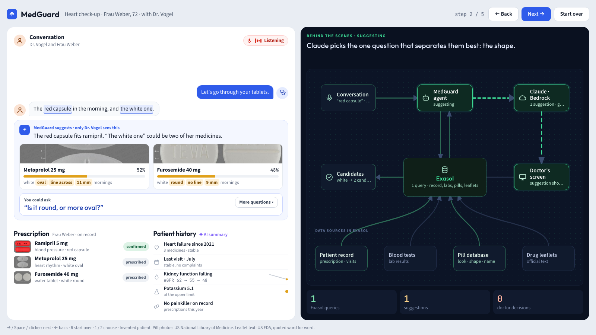
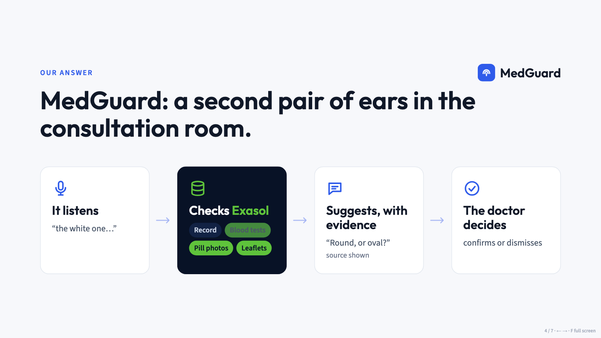
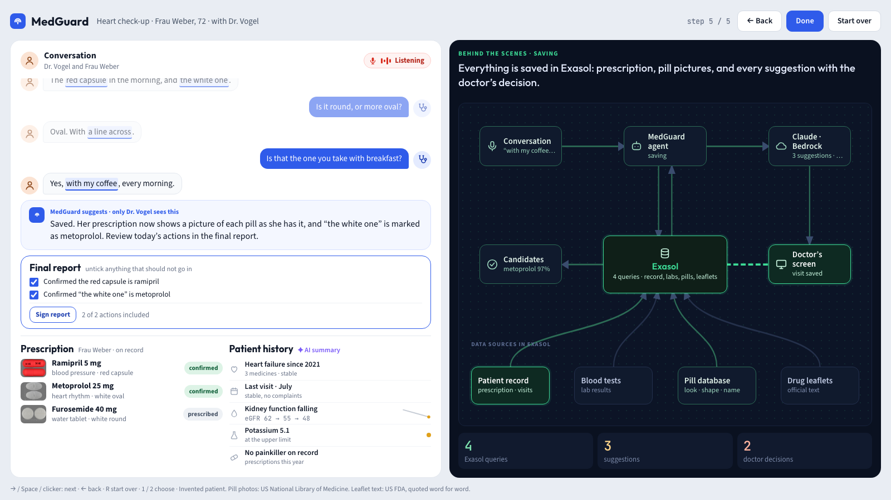

# MedGuard

**A second pair of ears in the consultation room.**

MedGuard follows the conversation between a doctor and a patient. When the patient can only describe a medicine
(*"the red one, and the white one"*), it checks her record, blood tests, pill photos and the official drug leaflets in
**Exasol**, and suggests one simple question that tells the candidates apart. It always shows its evidence, says how sure
it is, and leaves the decision to the doctor.

Built in 3 days at **Healthcare Hackathon Bayern 2026** (Erlangen, 12–14 Nov) for **Challenge 3 · Exasol: Build
healthcare AI you can trust**.

**[▶ Try the demo](https://rakif215.github.io/hackathon26/)** · **[Pitch slides](https://rakif215.github.io/hackathon26/slides.html)**
(press → to step through, F for full screen)

## The problem

Doctors have a few minutes per patient. Older patients often take many medicines and don't know their names. They say
*"the white one"*, and that could be two different pills. Guessing is where mistakes happen, and a chatbot that answers
with confidence but no sources isn't something a doctor can trust.

## How it works

1. **It listens.** It picks up the medicines the patient describes in the conversation.
2. **It checks Exasol.** It joins her prescription, lab results, a pill-photo database and the official leaflets in one
   query, and finds the candidates.
3. **It suggests, with evidence.** Claude (on Amazon Bedrock) picks the one question that best separates the candidates,
   e.g. *"Is it round, or more oval?"*, and shows the pill photos and a confidence score for each one.
4. **The doctor decides.** Nothing is saved until the doctor confirms it. At the end, the doctor reviews and signs a
   report of every action.

## What makes it trustworthy

- **Evidence on every suggestion:** pill photos, the patient's own data and the leaflet text, quoted word for word.
- **Uncertainty is visible:** each candidate shows how likely it is, and MedGuard asks another question when it isn't sure enough.
- **A human decides:** the doctor confirms or dismisses every suggestion and signs the final report.
- **No dosing or diagnostic advice.**

## Status

This is a hackathon prototype. The demo is a **scripted walkthrough** of one consultation, so it runs the same way
every time. The Exasol schema (`sql/01_schema.sql`), the database client (`src/hackathon26/db.py`) and the Bedrock
client (`src/hackathon26/bedrock.py`) are built; wiring them into the live screen is the next step.

The patient is invented. Pill photos come from the US National Library of Medicine, and leaflet text from the US FDA.

## Tech

Exasol 2026 · Claude on Amazon Bedrock · Python · plain HTML/CSS/JS for the demo and slides · GitHub Pages

## Repo map

- `web/medguard-pitch.html`: the 5-step demo (a single self-contained file). `web/medguard-pitch-full.html` is the longer 12-step version.
- `web/slides.html`: the animated pitch deck (built with `scripts/build_slides.py`).
- `sql/`, `src/hackathon26/`: the Exasol schema and the database and Bedrock clients.
- `docs/pitch-script.md`: the 3-minute pitch script.
- [PROJECT.md](PROJECT.md), [CONTEXT.md](CONTEXT.md), [SETUP.md](SETUP.md): scope, challenge briefs and local setup.

Run the demo locally: open `web/medguard-pitch.html` in a browser, then press → to go to the next step.

## Team MedGuard

Michael Hagen · Moeez Mujahid · Rakif Pathan
