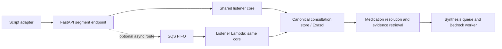

# Listener module and serverless integration — review draft

Date: 2026-11-13. Supplements `2026-11-13-medguard-master-plan.md`; does not replace PROJECT.md or authorize live audio/prescribing.

## Verified current status

- FastAPI/Uvicorn and pytest/HTTPX dependencies have been added, but no FastAPI app or listener module exists yet.
- Bedrock now has explicit sandbox session resolution. `tests/unit/test_bedrock_session.py`: four tests passed during this review.
- Guardrail provisioning and preflight scripts exist. `ask()` still does not attach a Guardrail to Converse calls.
- The preflight schema check compares table names only; it does not prove columns, types, seeded content or working joins match.
- Read-only AWS inventory verified the expected sandbox in `us-west-2`: five workshop/platform Lambda functions, no API Gateway HTTP/WebSocket APIs, no API Gateway REST APIs, no SQS queues, and a Guardrail named `medguard-clinical-safety`. These list calls returned no pagination tokens.
- Existing Lambda names indicate workshop infrastructure, not MedGuard application services. Do not modify them. Resource creation permissions, Guardrail version/behavior and database connectivity have not been established by this inventory.
- Existing uncommitted implementation edits belong to ongoing work; this review does not overwrite them.

## What “listener” means

For the MVP, the listener consumes finalized doctor/patient transcript segments from the versioned demo script. It extracts medication mentions and evidence spans, records uncertainty, and requests clarification. Audio acquisition and speech recognition are separate input adapters.

Recommended first deliverable: a transport-independent Python module with a FastAPI adapter and a thin Lambda adapter. It can be implemented and tested independently before the entire application exists.

Alternative: implement a transcription service first. This adds audio transport, speaker attribution, consent/session controls, drug-name ASR errors and partial-transcript corrections. Defer it because PROJECT.md explicitly excludes live audio. A later scope decision can add Amazon Transcribe without replacing the listener.

## Proposed contract

```json
{
  "schema_version": "1",
  "event_id": "unique-delivery-id",
  "consultation_id": "consultation-1042",
  "segment_id": "segment-007",
  "revision": 1,
  "sequence": 7,
  "speaker": "PATIENT",
  "text": "I take a little white one, and something for my knee.",
  "is_final": true,
  "source": "script",
  "occurred_at": "2026-11-13T10:00:00Z"
}
```

`source` initially supports only `script`; a future adapter may add `transcribe`. Speaker may be UNKNOWN; do not guess clinical speaker identity. Sequence belongs to the consultation, not arrival order. Source timing and text revision are separate from processing timestamps.

Output: `ListenerResult` with event/segment/consultation identifiers, processing version/status, extracted mentions, limitations and clarification proposals. Each mention includes raw text, start/end offsets into the original segment, kind (`NAME`, `APPEARANCE`, `INDICATION`), assertion (`AFFIRMED`, `NEGATED`, `UNCERTAIN`), subject (`PATIENT`, `OTHER`, `UNKNOWN`), temporal context and descriptive confidence basis. Candidate medication resolution is downstream and must not be mistaken for extraction confidence.

Use half-open Python Unicode character offsets and test non-ASCII text. Frontend consumers must convert offsets correctly if slicing JavaScript UTF-16 strings. Document this explicitly in generated API types.

“Something for my knee” produces an indication-based, unidentified medicine mention. It does not establish ibuprofen or NSAID exposure. “I no longer take ibuprofen” is historical/negated current use. “My husband takes it” is another person's medication. Clarification cannot turn into a confirmed drug without additional evidence and clinician action.

## Module boundaries

| Proposed file | Responsibility |
|---|---|
| `src/hackathon26/listener/models.py` | Segment, mention and result contracts |
| `src/hackathon26/listener/detect.py` | Pure `detect_mentions(segment) -> ListenerResult` |
| `src/hackathon26/listener/service.py` | Idempotency, sequence/revision validation, persistence boundary |
| `src/hackathon26/listener/http.py` | FastAPI router; no domain logic |
| `src/hackathon26/listener/lambda_handler.py` | Decode queue records, invoke service, report failed records |
| `tests/unit/test_listener.py` | Meaning, spans, negation, attribution, timing |
| `tests/api/test_listener.py` | Validation, duplicate/conflicting events, dependency errors |
| `infra/listener/template.yaml` | Proposed SAM resources, authored after contracts are reviewed |

`ListenerService.process(segment: TranscriptSegment) -> ListenerResult` uses injected storage/publisher interfaces. Detection has no boto3, FastAPI, database or model dependency. Start with a curated demo vocabulary and contextual rules; measure false positives before adding bounded model extraction for difficult cases.

## Local and serverless routes



Choose exactly one processing route per consultation. Never execute both local and queued processing for the same command. An asynchronous HTTP adapter returns 202 plus operation ID; snapshot polling shows pending/completed/failed. The browser does not infer success from queue acceptance.

### Service choices

| Service | Initial role | When needed |
|---|---|---|
| FastAPI | Session commands, snapshots, clinician review and local listener adapter | First vertical slice |
| Lambda | Short listener jobs; later synthesis and reference-import workers | First independent cloud component |
| SQS FIFO | Ordered delivery using consultation ID as message group | When asynchronous cloud processing is introduced |
| Exasol | Patient context, drug knowledge, findings and audit | Authoritative clinical/evidence store |
| DynamoDB | Optional conditional-write job/idempotency ledger | Only if direct Exasol job persistence is impractical |
| API Gateway | Cloud HTTP entry point | Only when clients need a deployed endpoint |
| S3 | Private versioned reference assets / labeled synthetic recordings | On demand; no public buckets |
| CloudWatch | Operational logs, failures and duration metrics | Every deployed worker; avoid full transcript logging |
| EventBridge / Step Functions | Later fan-out / multi-step orchestration | Defer until a concrete workflow requires them |
| Amazon Transcribe | Future audio-to-segment adapter | Explicit scope change only |

Do not create one service per arrow. Start with one listener Lambda plus queue only when the local contract works; add the synthesis worker when it has useful independent behavior. Deploying FastAPI itself on Lambda is an option to evaluate later, not a prerequisite for Lambda workers.

## Ordering, persistence and integration requirements

- SQS FIFO message groups preserve per-consultation ordering, but Lambda/SQS processing can still be repeated. Use persistent idempotency, not an in-memory cache or FIFO deduplication alone.
- Idempotency key includes consultation, segment, revision and processor version; also compare payload hash. Identical retries return prior output; conflicting same-key payloads fail visibly.
- Sequence gaps stay pending or return a retryable conflict; do not silently infer missing conversation. A poison message needs a dead-letter policy and explicit operator recovery, including how later sequence gaps are handled.
- Commit result and an outbox event together in the authoritative store before publishing downstream work. If optional DynamoDB is used for queue coordination, define an explicit retry/reconciliation handoff to Exasol; do not claim cross-database atomicity.
- Start with batch size one for the listener; retry/failure behavior must be tested before larger batches. Queue visibility timeout, worker timeout and retry budget are configured together.
- Neither a process-local limiter nor Lambda concurrency alone establishes the workshop's account-wide one-request-per-second Bedrock cap. Centralize all app model calls behind one paced worker and coordinate other team callers. Use a persistent minimum-interval gate if calls can originate across processes/cold starts.
- Keep the listener model-free initially. Synthesis calls are separate, bounded, validated and Guardrails-enabled.
- Decide Exasol location/connectivity before putting DB-dependent workers in AWS. Lambda cannot reach the developer laptop's loopback address. A cloud Exasol deployment still needs verified routing, TLS pinning, credentials and restricted access; no public database exposure as a shortcut.
- Current `bedrock.session()` intentionally forces a local named profile. AWS Lambda should use a dedicated execution role, not uploaded developer credentials. Because repository instructions currently forbid machine AWS credential inheritance, document and approve a distinct role-based cloud runtime policy before deployment; keep strict sandbox-account checks and local isolation tests.
- Final speech segments only create durable findings. Future partial ASR results may be displayed as provisional; revised text must invalidate affected downstream artifacts without deleting historical clinician decisions.

## Build order and acceptance

1. **Contracts and pure detector:** validate the envelope, preserve exact spans, extract named/appearance/indication mentions, and test negation, attribution, ambiguous descriptions and Unicode. No cloud deployment required.
2. **Stateful service and FastAPI adapter:** inject storage; test duplicates, payload conflicts, sequence gaps, revisions and recoverable failures. Persist before returning completed status.
3. **Lambda adapter:** use the same fixtures/core; test record decoding, partial failures and retries locally. No new medical behavior in the adapter.
4. **Infrastructure proposal:** SAM template for a dedicated listener function, FIFO queue, DLQ, least-privilege role and bounded log retention. Validate templates; inspect sandbox permissions and Exasol networking before deployment.
5. **Cloud smoke test:** verify caller identity before mutations; send synthetic fixtures, observe an actual completed result, retry it, and inspect audit/idempotency state. Queue admission alone is not acceptance.
6. **Bind resolution/evidence/synthesis:** add one consumer at a time with versioned contracts and observable end-to-end state. Clinician review remains a separate explicit command.

Acceptance: one detector implementation behaves identically through local and Lambda adapters; retries do not duplicate mentions; unidentified medication stays unidentified; failure is visible; no live-audio dependency is added to the MVP.

## AWS references used for this design

- SQS/Lambda delivery and duplicate processing: https://docs.aws.amazon.com/lambda/latest/dg/with-sqs.html
- FIFO message-group ordering: https://docs.aws.amazon.com/AWSSimpleQueueService/latest/SQSDeveloperGuide/fifo-queue-lambda-behavior.html
- Lambda execution-role credentials: https://docs.aws.amazon.com/sdkref/latest/guide/access.html
- Lambda VPC connectivity: https://docs.aws.amazon.com/lambda/latest/dg/configuration-vpc-internet.html
- Transcribe partial/final segments: https://docs.aws.amazon.com/transcribe/latest/dg/streaming-partial-results.html

This review added documentation only. No AWS resources were created or changed; no live Exasol schema/data check was performed.
