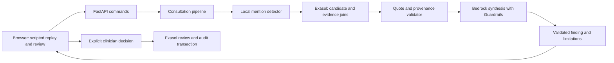

# MedGuard FastAPI Master Implementation Plan

> **For agentic workers:** REQUIRED SUB-SKILL: Use superpowers:subagent-driven-development or superpowers:executing-plans to implement approved work packages task-by-task. Steps use checkbox syntax for tracking. This is a review draft and decomposition map, not authorization to implement every proposed extension.

**Goal:** Deliver a repeatable, synthetic consultation demo that resolves ambiguous medication mentions, surfaces an unrecorded medicine, retrieves patient-specific interaction evidence from Exasol, and records an explicit clinician decision.

**Architecture:** One FastAPI application coordinates deterministic extraction, Exasol retrieval, evidence validation, Bedrock synthesis, and clinician review. The browser renders API results and controls scripted playback. Exasol owns persisted clinical context, provenance, findings, and review decisions; Claude phrases grounded results rather than deciding medication identity or treatment.

**Tech stack:** Python 3.11+, FastAPI, Pydantic, Uvicorn, existing pyexasol and boto3 helpers; pytest and HTTPX for backend verification. Proposed frontend: a small Vite/React/TypeScript application based on the downloaded pitch design; frontend choice remains reviewable. Avoid additional infrastructure for the MVP.

**Spec:** `PROJECT.md` is authoritative; `CONTEXT.md` and `SETUP.md` supply constraints. Reference artifact: `MedGuard Design Directions – Pitch view · 10 steps, suggestions.html`, provided in Downloads. This plan records proposed implementation decisions, not changes to approved scope.

## 1. Global constraints

- Synthetic patient data only; public drug-reference material may be imported with provenance.
- No dosing, diagnosis, prescribing, or autonomous medication changes.
- Every finding includes evidence, an uncertainty signal, limitations, and a clinician review path.
- Never translate an absent interaction hit into “safe”; use “no documented interaction found,” with coverage limitations.
- Every interaction claim quotes an actual stored label section; validate the quote before publication.
- Match appearance within the selected patient's medication list; do not imply universal pill identification.
- Scripted transcript only. Live audio and speech recognition are outside MVP scope.
- AWS sandbox profile `hackathon`, region `us-west-2`; use the isolated configuration files described in local `.kiro/steering/aws-context.md`. Never inherit unrelated machine credentials.
- Verify the sandbox account before any resource mutation. Never print or commit credentials.
- Bedrock calls stay below one request per second account-wide. Initial deployment uses one application process and one shared call coordinator; no multiworker deployment until shared rate limiting exists.
- Ship the five PROJECT.md MVP items before artifact extensions.

## 2. What exists and what remains unverified

| Area | Existing material | Implication |
|---|---|---|
| Product | PROJECT.md, CONTEXT.md | Consultation assistant is the current scope. |
| Older proposal | docs/product-idea.md | Historical interaction-only design; do not implement it as the primary flow. |
| Local UI | web/prototype.html | Hardcoded transcript and findings, useful as a behavior reference. |
| Design sources | web/design/*.dc.html, canvas.json | Preserve as references; custom design runtime is not established as a production dependency. |
| Downloaded pitch | Self-contained HTML export | Richer flow with branching, photos, task suggestions, and architecture animation. |
| Exasol | db.py and sql/01_schema.sql | Connection helper and 16-table schema exist; actual local schema/data have not been inspected in this planning turn. |
| Seed | seed.py | Older six-table design conflicts with newer PATIENT and AUDIT_LOG definitions; never run reset blindly. |
| Bedrock | bedrock.py | Text helper exists; explicit sandbox session, structured validation, Guardrails integration and account-wide coordination need work. |
| Tests/API | No application API/test suite found | Establish a narrow service boundary and reproducible fixtures. |

The artifact's query counters, confidence percentages, Guardrails indicator, record updates and saved messages are presentation state, not proof of working integrations.

## 3. Scope boundaries

### P0: must work end to end

1. Load one synthetic patient and start a consultation using a versioned script.
2. Advance utterances manually or on a timer; replay deterministically.
3. Detect explicit names and vague appearance/indication mentions locally.
4. Return candidate medications, match basis, uncertainty, and a useful clarification question.
5. Surface an unknown painkiller without pretending its identity or class is established.
6. After explicit name confirmation, retrieve a documented interaction and this patient's dated labs from Exasol.
7. Render a grounded warning with exact source text, provenance, limitations, and review controls.
8. Record accepted, overridden or deferred findings with an audit trail.
9. Reload the consultation and recover the same persisted state.

### P1: only after P0 passes

- Patient-reported adherence notes, explicitly distinguished from verified facts.
- Visit task suggestions and a draft visit summary, each requiring a recorded decision before saving as accepted.
- Pill photos with provenance and manufacturer/product caveats.
- Architecture animation driven by real backend events.
- Longer pitch script including dizziness and the optional adherence branch.

### Deferred

Live microphone, EHR integration, actual prescribing/order entry, production authentication, multilingual support, global pill search, vector search/Bedrock Knowledge Bases, multiuser hosting, autonomous agents, serverless deployment and broad drug coverage.

The artifact's “pause ibuprofen” becomes a proposed documentation action, never an automatic prescription update. Production use and clinical validation are separate projects.

## 4. Approaches and proposed choice

| Approach | Benefit | Cost | Recommendation |
|---|---|---|---|
| FastAPI + existing plain HTML/JS | Shortest path to a functional demo | More manual management of branching and evidence UI | Viable contingency if frontend time is very short. |
| FastAPI + small React/TypeScript UI | Clear state rendering and maintainable artifact-style panels | Adds a frontend build setup | Proposed default; keep it small and ship one screen first. |
| Distributed agent/serverless system | Possible later scale/integration | More deployment, debugging, ordering and rate-limit work | Defer beyond the hackathon. |

Use REST commands with complete updated snapshots initially. This avoids WebSocket/SSE ordering and reconnection work. Add event streaming only if a measured user need remains after the demo works.

## 5. System flow and responsibility boundaries



- Detection extracts what was said, including character spans; it does not infer an exact drug from knee pain.
- Resolution ranks available patient-specific candidates and preserves ambiguity.
- Interaction logic uses curated drug/class relations and source sections; no LLM-generated SQL.
- Lab context uses dated, unit-checked results. Missing, stale and incompatible observations remain visible.
- Synthesis receives only a bounded evidence packet. It may summarize it but cannot invent sources, confidence, or actions.
- Review writes only explicit clinician choices. Navigation, timeout and replay never count as approval.
- Presentation derives status from persisted state and actual integration outcomes.

## 6. Canonical data model and migration policy

Adopt `sql/01_schema.sql` as the starting vocabulary. Before changes, inspect catalog metadata and row counts read-only, compare with both schema definitions, and record the reconciliation. Do not run CREATE OR REPLACE or the old seed reset on a populated schema.

Use numbered, explicit migrations under `sql/migrations/`, plus a migration ledger. Test DDL behavior on a disposable schema; do not assume Exasol DDL rollback semantics. Seed operations are idempotent, target only named demo records and never erase unrelated rows.

Required model changes to design and verify in work package B:

- Consultation state: script version, current sequence, status, revision, created/updated timestamps.
- Unique processing identity per consultation and utterance sequence; duplicate requests return existing results.
- Mention state: unresolved/candidates/confirmed/rejected, optional resolved class, actor and confirmation time. An indication-only hypothesis is separate from a confirmed medicine.
- Appearance provenance: product/manufacturer/strength, source and synthetic flag; avoid equating ingredient with a universal appearance.
- Evidence relations: a finding can involve several medicines and several sections. Replace the single-pair limitation using junction tables if needed for the triple combination.
- Structured lab links: findings reference actual LAB_ID rows and rule versions, not just a free-text summary.
- Curated interaction rules identify exact required ingredients/classes, source sections, severity basis and version. RISK_LAB_RULE alone cannot encode the complete combination.
- Label provenance: source URL, document/set ID, effective date, fetch timestamp and content hash.
- Stable unique identifiers for events/reviews/findings; choose one allocator strategy and avoid MAX(id)+1 under concurrency.
- Review idempotency key, expected revision, reviewer identity, decision and note. Preserve earlier decisions when superseded.
- Audit events have consultation ID, sequence, event type and safe metadata; retain model/config identifiers without credentials.

Store eGFR and potassium with units and measurement dates. The demo's 62 → 55 → 48 and potassium 5.1 are synthetic fixture values, not general treatment thresholds. Any threshold rule needs its own source and explicit review.

## 7. API contract proposal

Base path `/api/v1`. Pydantic models reject unknown enum values and malformed identifiers. No endpoint accepts SQL, arbitrary URLs to fetch, or executable prompts.

| Method and path | Purpose | Important behavior |
|---|---|---|
| GET /health/live | Process health | No external API call. |
| GET /health/ready | Readiness | Exasol/config status; model capability reported separately without repeated paid calls. |
| GET /patients/{patient_id} | Synthetic patient context | Current meds, dated labs, provenance; 404 for absent patient. |
| GET /scenarios | Versioned scripts | Returns supported demo scenarios. |
| POST /consultations | Create session | Patient/scenario/reviewer plus idempotency key. |
| GET /consultations/{consultation_id} | Restore current state | Complete snapshot and revision. |
| POST /consultations/{consultation_id}/advance | Process next utterance | expected_revision and idempotency_key; server chooses next script sequence. |
| POST /consultations/{consultation_id}/mentions/{mention_id}/resolution | Confirm/reject candidate | Candidate must belong to that mention; explicit human action. |
| POST /consultations/{consultation_id}/findings/{finding_id}/reviews | Accept/override/defer | expected_revision and idempotency_key; override requires note. |
| GET /consultations/{consultation_id}/audit | Inspect provenance | Ordered persisted events; no secrets. |

Restart creates a new consultation; it does not delete audit history. Back navigation shows historical presentation state and cannot roll back persisted review actions.

Snapshot fields: `consultation`, `revision`, `utterances`, `mentions`, `findings`, `reviews`, `events`, `capabilities`, `limitations`. Finding fields: ID, involved drug IDs, severity and basis, evidence list, lab links, resolution uncertainty, synthesis status, limitations and review state.

Each evidence item includes section ID/type, exact quote, label set ID, source URL, effective date, fetched timestamp and verification status. Use descriptive match levels with basis by default; artifact percentages are not calibrated probabilities and must not be presented as such.

Errors use stable `{code, message, retryable, request_id}` envelopes: 404 absent resource, 409 stale revision/state conflict, 422 invalid command, 503 required dependency unavailable. Client retries reuse idempotency keys. Dependency errors never create a clean/no-interaction result.

## 8. Processing, transactions and failure behavior

1. Validate consultation ownership, revision and command identity; serialize mutations per consultation.
2. Reserve a processing operation with a unique key; do not hold a DB transaction open across a model call.
3. Detect mentions and retrieve candidates/context through parameterized queries.
4. Build and validate the evidence packet. Unsupported claims cannot become findings.
5. Queue at most one synthesis request at a script pause, not per utterance. Bounded timeout and retries share the same limiter.
6. Validate structured output against packet IDs and quotes; record Guardrails outcome.
7. Persist results, operation completion and audit events atomically, with revision conflict protection.
8. Return the committed snapshot. On model failure, return verified retrieval evidence with an explicit synthesis-unavailable state, rather than fabricated AI prose.

Specify recovery of reserved operations after interruption in package C: retries must not duplicate findings or decisions, and a stale worker may not overwrite a newer revision. A one-process demo can use a per-consultation mutex, but database uniqueness and revision checks remain necessary for retries and restarts.

Use synchronous FastAPI handlers or a bounded thread pool for blocking pyexasol/boto3 work. Never share a single mutable Exasol connection across unrelated request threads. Bound external calls and database statement durations; set final timeout values after a measured vertical slice.

Guardrails status is `active`, `blocked`, `unavailable`, or `not_configured`; only an actual successful configured invocation earns “active.” Recorded demo mode is prominently labeled, and cached/fixture results never masquerade as live calls.

## 9. Frontend behavior and artifact corrections

Retain the artifact's conversation, medication/context panel, suggestion card and optional workflow view. The primary clinician surface emphasizes the current question/finding; engineering logs belong in a secondary evidence/workflow view.

- UI starts with patient and synthetic-demo identification, then explicit start/play/pause/next controls.
- Highlight only spans returned by the backend; reveal suggestions when their operation completes.
- Show competing candidates and discriminating attributes; leave unresolved mentions unresolved until confirmed.
- Treat patient-reported medicines as “reported, not on recorded list,” rather than asserting they were never prescribed.
- A risk card shows source quotation/link, dated lab trend with units, severity basis, uncertainty and “could not verify.”
- Accept, override and defer remain distinct; no preselected acceptance and no implicit decision on Next.
- Disable duplicate commands while pending, preserve request keys, and restore server state after errors/reload.
- A failed save remains visibly unsaved. A completion banner requires a successful persisted response.
- Keyboard navigation cannot bypass required state checks; clinician choices remain deliberate.
- Source links, controls and status messages are accessible by keyboard. Verify desktop demo dimensions and a narrower laptop viewport.

Specific reference defects to avoid: its `chosen()` defaults earlier steps to option zero; logs can claim confirmation regardless of actual choice; optional question branches and skip choices do not consistently gate later steps; the advertised ten-step flow includes an extra adherence step. Use the actual scenario node count and recorded decisions.

## 10. Proposed file responsibilities

```text
src/hackathon26/
  api/app.py                 app factory, dependencies, static app mounting
  api/routes.py              HTTP commands and error mapping
  api/models.py              request/response contracts
  config.py                  validated app settings and capabilities
  db.py                      existing connection resolution
  repository.py              parameterized persistence and transactions
  consultation.py            command orchestration and revision rules
  mentions.py                local detection and candidate resolution
  interactions.py            curated combination matching and lab context
  evidence.py                quote/provenance verification
  synthesis.py               bounded evidence packet and output validation
  bedrock.py                 isolated session, limiter, Guardrails invocation
  seed.py                    reconciled demo loader
data/demo/                   versioned patient and transcript fixtures
data/reference/              source snapshots and curated rules with provenance
sql/migrations/              additive, numbered schema changes
scripts/                     import, preflight and explicitly scoped seed commands
tests/unit/                  pure domain and validation tests
tests/api/                   API contract and command-state tests
tests/integration/           opt-in disposable Exasol/live Bedrock checks
web/app/                     proposed frontend source and build configuration
docs/superpowers/plans/      master and later package plans
docs/demo-runbook.md          startup, reset, rehearsal and failure paths
```

Keep files small by responsibility; split repository or routes by feature only when growth warrants it. Do not introduce a generic agent framework, ORM or plugin architecture for this demo.

## 11. Work packages and dependency graph

| ID | Deliverable | Depends on | Parallel opportunity | Review gate |
|---|---|---|---|---|
| A | Approved contracts and synthetic scenario | None | Reference provenance research | Scope/contracts agreed |
| B | Canonical schema, migrations, demo seed | A | UI shell against agreed fixtures | Data/schema reconciliation |
| C | FastAPI consultation commands and persistence | A, B | UI implementation after A | Retry/revision behavior |
| D | Mention detection and resolution | A, B | Evidence importer | Ambiguity remains visible |
| E | Reference ingestion, interaction/lab retrieval | A, B | D | Exact source support |
| F | Bedrock synthesis and Guardrails | A, E | UI integration on fixtures | Grounding and failure handling |
| G | Clinician review and audit | C, E | F | Explicit atomic decisions |
| H | Integrated frontend and evidence view | A; integrates C–G | Shell may start after A | No simulated success states |
| I | End-to-end verification and demo handoff | B–H | Runbook drafting earlier | Five MVP items demonstrated |
| J | Optional artifact extensions | I | Separate small packages | Scope/time review |

Critical path: A → B → C/E → F/G → H → I. Build a minimal visible path through this graph early; do not finish every subsystem before the first integration.

## 12. Package acceptance and subdivision seeds

Each package becomes a separate detailed plan under this directory after review. Each implementation task names exact files, consumed/produced interfaces, a failing test, the smallest implementation, a passing command and a small commit. The checks below are proposed test requirements, not claims of tests already run.

### A. Contracts and canonical scenario

- [ ] Record decisions on frontend, live-versus-recorded mode, script length and P1 exclusions.
- [ ] Create `data/demo/consultation-v1.json` containing patient, current meds, appearance variants, dated labs and timestamped utterances.
- [ ] Define Pydantic snapshot/command/evidence types in the package plan before parallel work.
- [ ] Define a branch where the clinician remains uncertain and one where a finding is overridden.
- [ ] Verify fixture parsing, candidate references and chronological lab dates using `uv run pytest tests/unit/test_scenario.py -q`.

Acceptance: one deterministic story covers ambiguity → clarification → unrecorded medicine → source-backed risk → explicit review; no clinical treatment recommendation is added by the assistant.

### B. Database and reference-ready seed

- [ ] Inspect the live catalog read-only and document old/new schema differences; inspect legacy data before any mutation.
- [ ] Specify additive migrations and version ledger; validate in an isolated test schema.
- [ ] Replace the incompatible seed DDL with canonical inserts/upserts and an explicit demo-only reset path.
- [ ] Seed stable patient, medicines, appearance records, labs and script rows; import sources through package E.
- [ ] Verify a second seed run changes no counts and does not remove a non-demo sentinel row.
- [ ] Run `uv run pytest tests/integration/test_schema_seed.py -q` against a configured disposable schema.

Acceptance: schema and Python data types agree; the demo can be reloaded without destructive replacement; no credentials appear in fixtures or logs.

### C. FastAPI and consultation command state

Proposed interfaces: `create_app() -> FastAPI`; `ConsultationService.create(command) -> ConsultationSnapshot`; `advance(consultation_id, command) -> ConsultationSnapshot`; `get_snapshot(consultation_id) -> ConsultationSnapshot`.

- [ ] Add FastAPI/Uvicorn/Pydantic and test dependencies, app factory, safe settings and health endpoints.
- [ ] Implement patient/scenario retrieval, consultation creation and snapshot restoration with repository injection.
- [ ] Implement persisted advancement, operation identity, revision conflicts and interrupted-operation recovery.
- [ ] Test unknown patients, duplicate requests, concurrent advancement, stale revisions, API restart and database outage.
- [ ] Run `uv run pytest tests/api/test_consultations.py tests/unit/test_consultation_state.py -q`.

Acceptance: one utterance is processed at most once per command identity; no server crash or retry silently advances twice.

### D. Mentions and medication resolution

Proposed interfaces: `detect_mentions(utterance) -> list[MentionDraft]`; `resolve_candidates(mention, patient_context) -> ResolutionResult`. Exact types are fixed in package A.

- [ ] Implement span-aware detection for the versioned vocabulary without a model call per utterance.
- [ ] Rank patient-list candidates using appearance/name evidence and deterministic match tiers.
- [ ] Return rival candidates and a clarification question when attributes overlap; unknown painkillers remain unconfirmed.
- [ ] Persist explicit confirmation/rejection via the resolution API and audit it.
- [ ] Test negation, family-member references, historical/stopped medicines, generic appearance changes, zero candidates and conflicting attributes.
- [ ] Run `uv run pytest tests/unit/test_mentions.py tests/api/test_resolution.py -q`.

Acceptance: “white one” does not silently pick a winner; “something for my knee” does not become confirmed ibuprofen or a confirmed NSAID.

### E. Evidence import and patient-specific retrieval

Proposed interfaces: `verify_quote(quote, section_text) -> bool`; `retrieve_findings(consultation_id, confirmed_drug_ids) -> list[EvidencePacket]`.

- [ ] Select the narrow demo drug set and retrieve official label sections using an explicit import command, not browser page scraping during an appointment.
- [ ] Store exact original text, source IDs/URLs/dates/hash and import provenance; curate class synonyms and the combination rule.
- [ ] Implement parameterized Exasol joins across confirmed medicines/classes, rule/source sections and patient labs.
- [ ] Distinguish exact contiguous quotes from clearly marked excerpts; keep display normalization separate from source validation.
- [ ] Test fabricated/mismatched quotations, unsupported classes, no interaction hit, missing source, wrong patient, stale/missing labs and incompatible units.
- [ ] Verify the same medicines with changed or missing synthetic labs yield different context/limitations while preserving the same supported source claim.
- [ ] Run `uv run pytest tests/unit/test_evidence.py tests/unit/test_interactions.py -q` and opt-in `tests/integration/test_exasol_retrieval.py`.

Acceptance: the warning traces to stored rows and a real document; no hit and failed retrieval have visibly different states. Do not claim source content is verified until imported and checked.

### F. Bedrock synthesis and Guardrails

Proposed interface: `synthesize(packet: EvidencePacket) -> SynthesisResult`; result includes status, validated summary, source IDs, limitations, model ID and Guardrails outcome.

- [ ] Fix credential isolation through an explicit sandbox session/configuration path; inspect local AWS guidance without exposing values.
- [ ] Build a bounded structured prompt using only approved packet fields; avoid raw SQL, secrets and unnecessary patient identifiers.
- [ ] Configure or attach a sandbox Guardrail only after verifying caller identity; document its intended coverage and test actual behavior.
- [ ] Validate output schema and reject unknown IDs, invented quotations, unsupported assertions and prohibited advice. Guardrails supplement application validation.
- [ ] Route calls and bounded retries through the one-process coordinator, including failed/throttled calls; document account sharing with other team callers.
- [ ] Test malformed output, prompt-like transcript content, Guardrails block, expired credentials, timeouts and quota errors using fake clients.
- [ ] Run `uv run pytest tests/unit/test_synthesis.py tests/unit/test_bedrock.py -q`; separately run one opt-in sandbox smoke test.

Acceptance: synthesis failure leaves the verified evidence visible with an honest unavailable status; UI never reports Guardrails active from configuration alone.

### G. Clinician review and durable audit

Proposed interface: `review_finding(consultation_id, finding_id, command) -> ConsultationSnapshot`.

- [ ] Define accepted/overridden/deferred transitions and a required override note.
- [ ] Atomically append review plus audit and advance revision; prevent cross-consultation references.
- [ ] Make repeated identical requests idempotent; reject the same key with a conflicting body.
- [ ] Test no-choice navigation, concurrent reviewers, failed commit, retries and restored review history.
- [ ] Run `uv run pytest tests/api/test_reviews.py tests/integration/test_review_transaction.py -q` with the latter opt-in.

Acceptance: a decision exists only after an explicit successful command; failed writes never show a saved acknowledgement.

### H. Frontend integration

- [ ] Build the smallest artifact-style screen against agreed API fixtures: transcript, candidates, findings and review controls.
- [ ] Wire start/advance/resolve/review/restore; keep authoritative state in backend snapshots.
- [ ] Add evidence detail with label link, exact quote, dated lab values/units, uncertainty and blind spots.
- [ ] Implement pending/error/retry states and clear live/recorded provenance indicators.
- [ ] Verify candidate clarification, skip/defer, override, reload and dependency failure in a browser.
- [ ] Run frontend typecheck/build and targeted interaction tests; record the selected browser tool and verification evidence in its package plan.

Acceptance: the P0 workflow is operable with mouse and keyboard on the demo laptop; workflow decorations cannot overstate backend activity.

### I. Verification and demo readiness

- [ ] Exercise a full API scenario through a disposable Exasol schema and a fake synthesizer in CI/local tests.
- [ ] Rehearse one live Bedrock/Guardrails path separately with sandbox credentials and controlled request pacing.
- [ ] Demonstrate uncertainty, source expansion, clinician override and audit restoration, not only the happy path.
- [ ] Write `docs/demo-runbook.md`: prerequisites, exact startup/seed commands, rehearsal, new consultation, failure messages and labeled recorded fallback.
- [ ] Capture commands/results and unmet limitations. Update PROJECT.md status only for work actually verified.

Acceptance: all five MVP items are demonstrable; source and lab provenance are inspectable; a failed cloud call or database save produces an honest visible outcome.

### J. Artifact extensions, separately reviewed

Create independent plans for adherence notes, task proposals, draft summaries and real-event workflow animation. Each uses explicit decisions and persistence. None expands into actual prescriptions or clinical orders. Do not spend the final build window on these while P0 has gaps.

## 13. Review focus and test ownership

| Failure/input | Required behavior | Owning package |
|---|---|---|
| Patient describes a pill shared by several candidates | Preserve ambiguity; no unearned confirmation | D |
| Patient denies taking a drug or describes someone else's medicine | Do not add it as an active personal medication | D |
| Source or lab unavailable, stale or mismatched | Show the specific limitation; do not imply safety | E |
| Retry/reload/concurrent command | No duplicate advancement, finding or review; conflict is explicit | C, G |
| Model injects advice, sources or an invalid response | Reject unsupported content; retain verified evidence with failure status | F |

Additional integration concerns: frontend stale snapshots, schema drift, missing image assets, accidental inherited AWS credentials, shared-account throttling, and failure between operation reservation and commit.

## 14. Verification layers and release gates

1. Pure tests: detection, candidate ranking, quote matching, lab selection, structured output and state transitions; no network.
2. API tests: dependency-injected repositories and synthesizers; exact response/error contracts and idempotency.
3. Exasol integration: opt-in disposable schema with actual joins and transaction behavior, no destructive default-schema reset.
4. Bedrock integration: opt-in limited smoke tests for credential isolation, output validation and actual Guardrails behavior.
5. Browser verification: complete consultation, alternative decision paths, reload, pending/error states and evidence readability.
6. Live rehearsal: repeat from a clean consultation at least twice, then intentionally exercise one dependency failure.

MVP release gate: five PROJECT.md items pass; no fabricated source/identity claims; no implicit clinician approval; no fake saved/Guardrails status; reproducible startup documented. Test output is evidence only when actually run during implementation.

## 15. Build order under hackathon time pressure

**First integration checkpoint:** one patient → one confirmed drug mention → one Exasol evidence packet → one visible finding → one persisted clinician review. Use fake synthesis initially, clearly labeled in development. This proves the core joins and review loop before polishing playback.

**Second checkpoint:** add ambiguous descriptions, clarification, unrecorded medicine and dated labs; preserve the entire pipeline through REST snapshots.

**Third checkpoint:** attach actual Bedrock and Guardrails with validation, rate limiting and failure paths; finish evidence UI and repeatable replay.

**Final checkpoint:** freeze new features, rehearse, fix blockers and document the fallback. Only then consider P1 items.

If time contracts: retain manual Next instead of autoplay; keep simple frontend styling; defer animation, photos, adherence and summaries. Preserve evidence, uncertainty, clinician decisions and the real Exasol join.

## 16. Decisions for review before implementation

Confirmed by the user: FastAPI backend; use the existing MedGuard idea and artifact as context; produce a detailed plan suitable for review and subdivision.

Proposed defaults to review:

1. Single local FastAPI process with REST snapshots, no streaming infrastructure.
2. React/TypeScript for a small frontend; plain HTML/JS is the speed contingency.
3. Five-item MVP first; adherence, paperwork and architecture animation are P1.
4. Explicit name confirmation before a specific ibuprofen finding; earlier concern is labeled an unconfirmed hypothesis.
5. Descriptive match confidence, not uncalibrated probability percentages.
6. Actual Exasol persistence and source retrieval; live Bedrock/Guardrails preferred, recorded fallback visibly labeled.
7. Scope remains clinician decision support; no real prescriptions or orders.

No product code, dependencies, database state or AWS resources are changed by this plan. After review, expand A/B/C first into exact implementation tasks; use their approved interfaces to split D/E/F/G/H safely across workers.
